# AIRE Workflow: End-to-End Flows

These diagrams show how the framework runs from start to finish.

## Index

1. [Greenfield End-to-End Flow: From Idea to Epic Release](#1-greenfield-end-to-end-flow-from-idea-to-epic-release)
2. [Brownfield End-to-End Flow: From Idea to Epic Release](#2-brownfield-end-to-end-flow-from-idea-to-epic-release)
3. [Bug End-to-End Flow: From Bug Ticket to Merged Fix](#3-bug-end-to-end-flow-from-bug-ticket-to-merged-fix)
4. [Enhancement End-to-End Flow: From Enhancement Ticket to Merged Change](#4-enhancement-end-to-end-flow-from-enhancement-ticket-to-merged-change)
5. [Mid-Epic Enhancement: epic-enhancement](#5-mid-epic-enhancement-epic-enhancement)
6. [Mid-Epic Bug Fix: epic-bugfix](#6-mid-epic-bug-fix-epic-bugfix)
7. [Mid-Epic Change Request: epic-change-request](#7-mid-epic-change-request-epic-change-request)
8. [Bug Lifecycle: From a Verification Engineer Finding a Bug to Closed](#8-bug-lifecycle-from-a-verification-engineer-finding-a-bug-to-closed)
9. [Existing-System Documentation: How It Stays Current](#9-existing-system-documentation-how-it-stays-current)
10. [AI-Origin Detection: Line-Level Defect Provenance](#10-ai-origin-detection-line-level-defect-provenance)


---

# 1. Greenfield End-to-End Flow: From Idea to Epic Release

A new project with no existing code, from the first idea to the merged Epic.

```mermaid
flowchart TD
    %% Ideation, before the AIRE workflow starts
    IDEA(["The user has an idea"])
    IDEA --> INTAKE["<b>The user runs the intent-intake skill</b><br/>The framework collects six baseline fields: the outcome,<br/>how success is measured, the success signal, what is out of scope,<br/>the known constraints, and the confidence level with open unknowns.<br/>It creates an Epic in Azure DevOps, labelled intent-intake."]
    INTAKE --> REFINE["<b>The user runs the intent-refinement skill</b><br/>The framework works through the Epic until it defines:<br/>measurable criteria with thresholds, scope, constraints,<br/>domain model, quality expectations and risks.<br/>It updates the same Epic created by intent-intake skill and adds the label intake-refined."]
    REFINE --> EPIC_READY["The Epic is fully detailed and ready to build.<br/>Both intent skills are optional."]

    %% Planning
    EPIC_READY --> TRIGGER["<b>The user starts the framework</b><br/>by typing <b>using aire annexus implement &lt;epic reference&gt;</b><br/>with an Azure DevOps link, <br/>or a request to implement an Epic present on ATLAS fetched through the Helix MCP."]
    TRIGGER --> WD["<b>Workspace Detection</b><br/>The framework takes the Azure DevOps project from the Epic link.<br/>It records the Parent Epic, copies the Epic content into <b>epic-brief.md."]
    WD --> BRANCH["<b>The framework creates the Epic branch</b><br/>named <b>epic/&lt;epic-id&gt;-&lt;epic-title&gt;</b>, cut from the current branch,<br/>which is your base branch (for example, a development branch).<br/>Both are recorded in runtime-artifacts/aire-state.md.<br/>The Epic branch holds only the cycle's documents; code goes on story branches."]
    BRANCH --> ATLAS_SYNC{"<b>ATLAS artifact question</b>, asked once by the framework in chat<br/>Push the artifacts the framework creates in this cycle<br/>(spec/, runtime-artifacts/, reports/; never code)<br/>to ATLAS through the Helix MCP?"}
    ATLAS_SYNC -->|"Yes: a team folder named after the cycle is created in ATLAS,<br/>and every artifact is pushed there before each commit"| CTX{"<b>Context question</b>, asked once by the framework in chat, in three parts:<br/>1) Existing knowledge about the current system,<br/>to be placed under spec/context-project/existing-knowledge/<br/>2) Reference materials for the new work, such as wireframes,<br/>mockups or API specifications,<br/>to be placed under spec/context-project/new-references/<br/>3) The team's coding guidelines as .md files, followed by all generated code,<br/>to be placed under spec/context-project/coding-guidelines/"}
    ATLAS_SYNC -->|"No: the artifacts stay in the repository only"| CTX
    CTX --> RA["<b>Requirements Analysis</b><br/>The framework reads epic-brief.md, chooses the depth<br/>(minimal, standard or comprehensive), and writes its questions<br/>to a file for user to answer."]
    RA --> RA_Q{"The user answers<br/>every question."}
    RA_Q -->|"An answer is unclear"| RA_FOLLOW["The framework asks follow-up questions<br/>until every decision is clear."]
    RA_FOLLOW --> RA_Q
    RA_Q -->|"Every decision is clear"| RA_GEN["The framework writes <b>requirements.md</b>.<br/>Every requirement gets a permanent identifier such as REQ-F-03.<br/><b>Document hooks</b> check every document AIRE writes, in this and every later stage,<br/>so it is never written before the documents it depends on are written,<br/>and make sure the document always contains the required sections.<br/>When a check fails, the hook fails and the framework fixes the document before it moves ahead."]
    RA_GEN --> RA_APPROVE{"<b>Requirements approval checkpoint</b><br/>The user chooses Request Changes<br/>or Approve and Continue."}
    RA_APPROVE -->|"Request Changes"| RA
    RA_APPROVE -->|"Approve and Continue"| RA_COMMIT["The planning documents are committed and pushed<br/>on the Epic branch. No pull request is raised here."]

    %% User stories and dependency graph
    RA_COMMIT --> US_GEN["<b>User Stories</b><br/>The framework writes <b>stories.md</b> and <b>personas.md</b> in one pass,<br/>for the pod size the user gives. Every story lists its acceptance criteria,<br/>the requirements it covers and the files it touches.<br/>The Story Tracker is filled in with status ToDo."]
    US_GEN --> STORY_CP{"<b>Story set approval checkpoint</b><br/>The framework presents the complete story set.<br/>The user chooses Request Changes or Approve and Continue."}
    STORY_CP -->|"Request Changes"| US_GEN
    STORY_CP -->|"Approve and Continue"| PUSH_TRK["<b>Push to the tracker</b><br/>Each story is created in Azure DevOps, set to ToDo,<br/>linked to the Parent Epic, and its tracker ID is written back."]
    PUSH_TRK --> TRK_STORIES[("The tracker now holds every story,<br/>each linked to the Parent Epic.")]
    PUSH_TRK --> DG["<b>Dependency Graph</b> (automatic)<br/>The framework works out which stories need which others first,<br/>writes <b>dependency-graph.yml</b>, and shows which stories can start now.<br/>The stories, personas and graph are then committed and pushed to the epic branch."]
    DG --> WP["<b>Workflow Planning</b> (automatic)<br/>The framework decides which design stages this Epic needs,<br/>records its reasons in <b>executions.md</b>, and continues."]
    WP --> AD["<b>Application Design</b> (Conditional)<br/>Components, methods, services and their dependencies,<br/>written to application-design.md and approved by the user."]

    %% System-level design
    AD --> FD["<b>Functional Design</b> (Conditional)<br/>Domain model, business rules, validation, data flows,<br/>integrations and edge cases written to functional-design.md and approved by the user."]
    FD --> NFR_R["<b>Non-functional Requirements</b> (Conditional)<br/>How fast, secure, reliable and scalable the system must be,<br/>recorded as measurable targets in nfr.md and approved by the user."]
    NFR_R --> NFR_D["<b>Non-functional Design</b> (Conditional)<br/>How those targets will be met, added to nfr.md."]
    NFR_D --> INFRA["<b>Infrastructure Design</b> (Conditional)<br/>Environments, hosting, storage, messaging, networking and monitoring,<br/>written to infrastructure-design.md and approved by the user"]

    %% Design handoff checkpoint
    INFRA --> ARCHDOC["<b>Design handoff checkpoint:</b><br/>The framework first writes <b>spec/plans/package-dependencies.md</b>:<br/>the package dependencies required for the implementation<br/>with their version numbers, which the user has to approve.<br/>Code generation installs only these versions.<br/>Then it assembles <b>spec/plans/architecture.md</b><br/>from the approved designs, then derives the architecture and security<br/>rubrics in spec/plans/judge-rubrics.md."]
    ARCHDOC --> UIUX{"<b>UI/UX Mockups</b> (only when the user opted in during Requirements Analysis)<br/>The framework builds HTML mockups of every screen (with Claude Design) and opens them in the browser,<br/>or, if Figma was chosen, designs every screen on a new page in the project's Figma file using Figma mcp,<br/>and revises the design until the user approves them.<br/>Code generation is later grounded in the approved mockups."}
    UIUX -->|"Request Changes"| UIUX
    UIUX -->|"Approved or not opted in"| SPECSET["<b>Test plans</b> (before any code)<br/>For every story, the manual test plan<br/>in <b>test-plans/&lt;epic-id&gt;-&lt;title&gt;/&lt;ticket-id&gt;-&lt;title&gt;/</b>.<br/>Every acceptance criterion needs at least one test case.<br/>The plans are pushed on <b>test-plans/&lt;epic-id&gt;-&lt;title&gt;</b> and a [TEST] pull request<br/>into the base branch is raised straight away, one folder per Epic.<br/>The Verification Engineer reviews them in that pull request.<br/>To change a test plan, the Verification Engineer runs <b>/ve-list-work</b> and chooses Option C.<br/>It updates the test plan on the test plans branch and updates the [TEST] pull request."]
    SPECSET --> DESIGN_PUSH["The design documents are committed and pushed on the Epic branch."]
    DESIGN_PUSH --> STOP["<b>Development handoff:</b><br/>The framework reports how many stories exist, which can start now,<br/>and which design stages ran or were skipped.<br/>Developer: type <b>dev-implement</b>, once per story."]

    %% dev-implement, one story at a time
    STOP -->|"The developer types dev-implement<br/>and names a story"| SS{"<b>Doability checkpoint</b><br/>Every prerequisite story must have its pull request<br/>merged into the base branch.<br/>The framework never merges a pull request itself."}
    SS -->|"A prerequisite story is not merged"| BLOCK["The run stops and names each unmerged prerequisite stories<br/>and its pull request state."]
    BLOCK -.-> SS
    SS -->|"Every prerequisite is merged"| INDEV["<b>The story's status changes from ToDo to In Progress automatically</b><br/>on the tracker and the Story Tracker, and the story is assigned<br/>to the developer automatically.<br/>When it is the first story to start, the Epic's status also changes<br/>from ToDo to In Progress automatically."]
    INDEV --> SBR["<b>Story branch checkpoint</b><br/>The base branch is refreshed. <br/>The branch <b>story/&lt;N.M&gt;-&lt;story-title&gt;</b> is cut from the base branch.<br/>It carries code and tests only; the story's state, audit and evidence<br/>are committed to the Epic branch."]
    SBR --> BASE["<b>Baseline</b> (before any code is written)<br/>The full test suite runs and the static evals take their baseline,<br/>so failures and findings already there are never blamed on this story."]
    BASE --> PLAN["<b>Plan</b><br/>The implementation plan is written, each step tagged with<br/>the requirements and acceptance criteria it serves."]
    PLAN --> GEN["<b>Code generation</b><br/>Application code goes into src/, unit tests into tests/unit/<br/>and API contract tests into tests/api/.<br/><b>Security hooks</b> check every new line of code as it is written<br/>against the <b>AIRE Security Baseline</b>, which maps to the <b>OWASP Top 10 (2025)</b>.<br/>When a check fails, the hook fails and the framework fixes the code before it moves ahead."]

    GEN --> COV{"<b>Unit tests and coverage</b><br/>Tests run, and coverage of the changed lines<br/>must reach 90 percent."}
    COV -->|"A test fails or coverage is short"| COV_FIX["The framework finds the cause and fixes the code,<br/>adding tests only for paths that are genuinely untested.<br/>It never deletes or weakens a test.<br/><b>Self-heals until the unit tests pass and coverage is at least 90%.</b>"]
    COV_FIX --> COV
    COV -->|"Pass"| API{"<b>API contract tests</b><br/>Only when the work adds or changes an endpoint, written in tests/api/:<br/>success, status codes, 401 and 403, request and response schema, error format."}
    API -->|"A test fails"| API_FIX["The framework finds the cause and fixes the endpoint,<br/>never the assertion.<br/><b>Self-heals up to 3 attempts.</b><br/>(After 3 failed attempts, the framework shows the error in the Claude chat<br/>and instructs you to fix it manually.)"]
    API_FIX --> API
    API -->|"Pass, or no endpoint changed"| REG{"<b>Full test suite</b><br/>The whole test suite, unit and API, runs again and is compared with the baseline.<br/>Only tests that passed before and fail now count."}
    REG -->|"A new failure"| REG_FIX["This story caused it, so this story fixes it,<br/>never by deleting or weakening the test.<br/><b>Self-heals up to 3 attempts.</b><br/>(After 3 failed attempts, the framework shows the error in the Claude chat<br/>and instructs you to fix it manually.)"]
    REG_FIX --> REG
    REG -->|"No new failures"| STAT{"<b>Static evals</b><br/>Lint, type check, security analysis, dependency vulnerabilities, secrets,<br/>complexity and licences, run as terminal commands and compared with the baseline.<br/>Only new findings in changed files count."}
    STAT -->|"A new finding"| STAT_FIX["The framework fixes the code,<br/>never by suppressing the finding.<br/><b>Self-heals up to 3 attempts.</b><br/>(After 3 failed attempts, the framework shows the error in the Claude chat<br/>and instructs you to fix it manually.)"]
    STAT_FIX --> STAT
    STAT -->|"No new findings"| JUDGE{"<b>Judge score checkpoint</b><br/>Architecture, against the architecture rubric from architecture.md<br/>Security, against the security rubric from the OWASP Top 10 (2025)<br/>Both must reach 0.85. An architecture score that does not apply passes."}
    JUDGE -->|"A score below 0.85"| JUDGE_FIX["The framework fixes the code at the lines the score cites,<br/>never the rubric or architecture.md, and scores again.<br/><b>Self-heals up to 3 attempts.</b><br/>(After 3 failed attempts, the framework shows the error in the Claude chat<br/>and instructs you to fix it manually.)"]
    JUDGE_FIX --> JUDGE
    JUDGE -->|"Both at 0.85 or above"| ACR["<b>Automated code review</b><br/>Checks every acceptance criterion and covered requirement,<br/>and runs the Security Baseline review on the changed code.<br/>A versioned report is written."]
    ACR --> RDG{"<b>Review result</b><br/>Clean, or are there blocker or high findings?"}
    RDG -->|"Findings"| REM["<b>Automatic remediation</b><br/>The framework fixes every blocker and high finding, runs the unit tests,<br/>the full test suite, the static evals and the judge scores again, and reviews again.<br/><b>Self-heals up to 3 attempts.</b><br/>(After 3 failed attempts, the framework shows the error in the Claude chat<br/>and instructs you to fix it manually.)"]
    REM --> ACR
    RDG -->|"Clean"| COMMIT["<b>Commit:</b><br/>The evidence files are checked, and the commit carries an AIRE-Version trailer."]
    COMMIT --> STORY_PR["<b>Story pull request</b> (through pr-generator)<br/>The developer is asked which branch the PR goes into,<br/>with the base branch as the recommended option.<br/>The story branch is pushed and a [STORY] pull request is opened<br/>into the chosen branch, labelled ai-generated and with the AIRE version.<br/>Its description carries the test and review results."]
    STORY_PR --> GH_STORY[("GitHub or Azure Repos: the story pull request<br/>targets the branch the developer chose.")]
    STORY_PR --> PR_REV["<b>Automatic pull request review</b><br/>The framework posts its review as a comment."]
    PR_REV --> RFD["<b>The story stays In Progress</b><br/>The pull request link is recorded.<br/>The framework never moves it further."]

    %% Merge and the next story
    RFD --> PR_HUMAN{"<b>Human review</b><br/>Reviewers review the story pull request;<br/>it is approved and merged manually.<br/>Approved, or changes requested?"}
    PR_HUMAN -->|"Changes requested"| PF_READ["<b>Pull request fix: the developer types pr-fix &lt;PR number&gt;</b><br/>It reads every unresolved review comment on the PR. <br/>It asks a question only when a comment would change an approved<br/>acceptance criterion, or when two reviewers disagree."]
    PF_READ --> PF_FIX["<b>Fix on the same story branch</b><br/>The fix is planned and made, then every dev-implement check runs again<br/>on the whole story, plus a check that each requested fix is correct."]
    PF_FIX --> PF_UPDATE["<b>Update the same pull request</b><br/>Commit and push, refresh the test and review results, reply to each comment,<br/>and post an automatic review.<br/>It never merges, approves or resolves review threads."]
    PF_UPDATE --> PR_HUMAN
    PR_HUMAN -->|"Approved"| MERGE_STORY["<b>The developer merges the story pull request</b> into the branch chosen for it,<br/>usually the base branch.<br/>The framework never merges on anyone's behalf.<br/>CI/CD deploys it to the DEV environment; the developer then moves the story<br/>to <b>Ready for Testing</b> on the board.<br/>A story that depends on this one can start only after this merge."]
    MERGE_STORY --> MORE{"More stories<br/>to build?"}
    MORE -->|"Yes: type dev-implement again"| SS
    MORE -->|"No"| ALL_DONE["Every story has been built and merged into the base branch.<br/>Verification Engineer testing has been running per story<br/>as each one reached the DEV environment."]

    MERGE_STORY -.->|"Each story deployed to the DEV environment, in parallel while the developer picks the next story"| SIGNOFF
    MERGE_STORY -.->|"optional"| NOVUS["<b>Novus test automation (optional)</b><br/>A developer or the Verification Engineer runs <b>/novus-automate</b><br/>with the story and a local or allowed URL. The framework walks the approved<br/>manual test plan in a browser, generates Novus tests under <b>tests/e2e/</b>,<br/>compiles and runs them once, and records every case's result.<br/>The tests go to the base branch in an [AUTO] pull request after the story merges.<br/>Never Verification Engineer sign-off."]
    ALL_DONE --> SIGNOFF["<b>Verification Engineer testing with /ve-list-work</b>, started from the base branch<br/>(for example, a development branch), story by story as each one reaches the DEV environment.<br/>The Verification Engineer moves the story to <b>In Testing</b> on the board manually (or with<br/>/ve-list-work Option A), runs its test steps in the DEV environment, and records one decision<br/>per story, for example 4822 approve.<br/>Approve: comment, ve-approved label, and the story moves to <b>Closed</b> on the board automatically.<br/>Reject: comment, ve-rejected label, and the story moves to <b>Bug fixing</b> on the board automatically.<br/>The Verification Engineer then runs the /raise-defect skill manually to log a bug<br/>with the status <b>New</b> on the board. The developer fixes it with epic-bugfix,<br/>which moves the bug to <b>Active</b> on the board automatically.<br/>The developer moves the bug to <b>Resolved</b> and the story back to <b>Ready for Testing</b><br/>on the board manually after the deploy to the DEV environment. The Verification Engineer retests the bug and records<br/>one decision, for example 4840 approve. Approve: the bug moves to <b>Closed</b> on the board automatically.<br/>Reject: it moves back to <b>Active</b> on the board automatically, with a comment.<br/>Approving the story's last open bug closes the story too.<br/>When every story is Closed, it offers to move the Epic to Closed."]

    %% Cycle close
    SIGNOFF --> EPIC_PR["<b>The user runs archive-epic on the Epic branch</b> once every story is Closed<br/>It writes the cycle's change record (delta.md), copies spec/, reports/<br/>and runtime-artifacts/ into aire-archives/epics/,<br/>and removes the archived folders from the Epic branch.<br/>The test plans are not archived: they stay on the base branch."]
    EPIC_PR --> ARCHIVE["<b>archive-epic raises the [EPIC] pull request</b><br/>into the base branch. It carries only the archive:<br/>the code already merged story by story."]
    ARCHIVE --> GH_EPIC[("GitHub or Azure Repos: the Epic pull request<br/>targets the base branch.")]
    ARCHIVE --> MERGE_EPIC["<b>The user merges the Epic pull request</b> into the base branch.<br/>This is always a human decision."]
    MERGE_EPIC --> DONE(["<b>EPIC COMPLETE</b>"])

    classDef intent fill:#EDE7F6,stroke:#5E35B1,stroke-width:2px,color:#1F1F1F
    classDef trigger fill:#CE93D8,stroke:#6A1B9A,stroke-width:3px,color:#1F1F1F
    classDef planning fill:#BBDEFB,stroke:#1565C0,stroke-width:2px,color:#1F1F1F
    classDef checkpoint fill:#FFF9C4,stroke:#F57F17,stroke-width:2px,color:#1F1F1F
    classDef design fill:#E1BEE7,stroke:#6A1B9A,stroke-width:2px,color:#1F1F1F
    classDef handoff fill:#B39DDB,stroke:#4527A0,stroke-width:3px,color:#1F1F1F
    classDef stop fill:#FFCDD2,stroke:#C62828,stroke-width:3px,color:#1F1F1F
    classDef build fill:#C8E6C9,stroke:#2E7D32,stroke-width:2px,color:#1F1F1F
    classDef verify fill:#C5E1A5,stroke:#33691E,stroke-width:2px,color:#1F1F1F
    classDef heal fill:#FFE082,stroke:#FF6F00,stroke-width:2px,color:#1F1F1F
    classDef review fill:#B3E5FC,stroke:#0277BD,stroke-width:2px,color:#1F1F1F
    classDef pr fill:#B2EBF2,stroke:#00695C,stroke-width:2px,color:#1F1F1F
    classDef vEng fill:#B2DFDB,stroke:#00695C,stroke-width:2px,color:#1F1F1F
    classDef close fill:#FFE0B2,stroke:#E65100,stroke-width:2px,color:#1F1F1F
    classDef prfix fill:#FFCCBC,stroke:#BF360C,stroke-width:2px,color:#1F1F1F
    classDef external fill:#FFFDE7,stroke:#F57F17,color:#1F1F1F
    classDef done fill:#A5D6A7,stroke:#2E7D32,stroke-width:3px,color:#1F1F1F

    class IDEA,INTAKE,REFINE,EPIC_READY intent
    class TRIGGER trigger
    class WD,BRANCH,RA,RA_FOLLOW,RA_GEN,RA_COMMIT,US_GEN,PUSH_TRK,DG,WP planning
    class ATLAS_SYNC,CTX,RA_Q,RA_APPROVE,STORY_CP,SS,COV,API,REG,STAT,JUDGE,RDG,MORE checkpoint
    class AD,FD,NFR_R,NFR_D,INFRA design
    class ARCHDOC,UIUX,SPECSET,DESIGN_PUSH handoff
    class STOP,BLOCK stop
    class INDEV,SBR,BASE,PLAN,GEN,COMMIT,RFD build
    class COV_FIX,API_FIX,REG_FIX,STAT_FIX,JUDGE_FIX heal
    class ACR,REM,PR_REV review
    class STORY_PR,MERGE_STORY pr
    class PR_HUMAN checkpoint
    class PF_READ,PF_FIX,PF_UPDATE prfix
    class SIGNOFF vEng
    class NOVUS vEng
    class ALL_DONE,EPIC_PR,ARCHIVE,MERGE_EPIC close
    class TRK_STORIES,GH_STORY,GH_EPIC external
    class DONE done
```

---

# 2. Brownfield End-to-End Flow: From Idea to Epic Release

A new project with existing codebase. 

```mermaid
flowchart TD
    %% Ideation and optional local baseline
    IDEA(["The user has an idea"])
    IDEA --> INTAKE["<b>The user runs the intent-intake skill</b><br/>Six baseline fields, and an Epic created in<br/>Azure DevOps, labelled intent-intake."]
    INTAKE --> REFINE["<b>The user runs the intent-refinement skill</b><br/>The Epic is elaborated until it is verifiable<br/>and labelled intake-refined."]
    REFINE --> EPIC_READY["The Epic is fully detailed and ready to build.<br/>Both intent skills are optional."]

    %% Planning
    EPIC_READY --> TRIGGER["<b>The user starts the framework</b><br/>by typing <b>using aire annexus implement &lt;epic reference&gt;</b><br/>with a tracker link<br/>or a request to implement an Epic present on ATLAS fetched through the Helix MCP."]
    TRIGGER --> WD["<b>Workspace Detection</b><br/>The framework takes the Azure DevOps project from the Epic link, records the Parent Epic,<br/>copies the Epic into <b>epic-brief.md</b>, finds the existing code,<br/>and records where that code lives (the Code Root)."]
    WD --> ATLAS{"<b>Existing-system truth</b><br/>Is spec/plans/atlas-deep-dive.md already here?<br/>If not, does ATLAS hold a deep dive, that can be fetched through the Helix MCP?"}
    ATLAS -->|"Found locally"| REUSE["The deep dive is reused as it is."]
    ATLAS -->|"Found on ATLAS"| PULL["The deep dive is copied verbatim into<br/><b>atlas-deep-dive.md</b> with its source recorded.<br/>ATLAS content is read-only."]
    ATLAS -->|"Not found, or Helix not connected"| CONNECT{"<b>Helix connect checkpoint</b><br/>A) Connect Helix MCP or create the deep dive on ATLAS, then rerun the framework.<br/>B) Continue without ATLAS and generate the Reverse Engineering documents locally."}
    CONNECT -->|"A"| HALT_A(["The workflow stops until Deep dive document on ATLAS and Helix MCP connection is available."])
    CONNECT -->|"B"| RE["<b>Reverse Engineering</b><br/>The framework analyses the code and writes the business overview,<br/>architecture, code structure, APIs, component inventory, technology stack<br/>and dependencies. Each document notes that ATLAS was not consulted.<br/>The user approves the result."]
    REUSE --> BRANCH
    PULL --> BRANCH
    RE --> BRANCH
    BRANCH["<b>The framework creates the Epic branch</b><br/>named <b>epic/&lt;epic-id&gt;-&lt;epic-title&gt;</b>, for the cycle's documents only,<br/>and records it with the base branch (for example: development branch) ."]
    BRANCH --> ATLAS_SYNC{"<b>ATLAS artifact question</b>, asked once by the framework in chat<br/>Push the artifacts the framework creates in this cycle<br/>(spec/, runtime-artifacts/, reports/; never code)<br/>to ATLAS through the Helix MCP?"}
    ATLAS_SYNC -->|"Yes: a team folder named after the cycle is created in ATLAS,<br/>and every artifact is pushed there before each commit"| CTX{"<b>Context question</b>, asked once by the framework in chat, in three parts:<br/>1) Existing knowledge about the current system,<br/>to be placed under spec/context-project/existing-knowledge/<br/>2) Reference materials for the new work, such as wireframes,<br/>mockups or API specifications,<br/>to be placed under spec/context-project/new-references/<br/>3) The team's coding guidelines as .md files, followed by all generated code,<br/>to be placed under spec/context-project/coding-guidelines/"}
    ATLAS_SYNC -->|"No: the artifacts stay in the repository only"| CTX
    CTX --> RA["<b>Requirements Analysis</b><br/>The framework reads epic-brief.md together with the existing-system<br/>documents, chooses the depth, and writes its questions to a file."]
    RA --> RA_Q{"The user answers<br/>every question."}
    RA_Q -->|"An answer is unclear"| RA_FOLLOW["The framework asks follow-up questions<br/>until every decision is clear."]
    RA_FOLLOW --> RA_Q
    RA_Q -->|"Every decision is clear"| RA_GEN["The framework writes <b>requirements.md</b>,<br/>with a permanent identifier for every requirement.<br/><b>Document hooks</b> check every document AIRE writes, in this and every later stage,<br/>so it is never written before the documents it depends on are written,<br/>and make sure the document always contains the required sections.<br/>When a check fails, the hook fails and the framework fixes the document before it moves ahead."]
    RA_GEN --> RA_APPROVE{"<b>Requirements approval checkpoint</b><br/>Request Changes or Approve and Continue."}
    RA_APPROVE -->|"Request Changes"| RA
    RA_APPROVE -->|"Approve and Continue"| RA_COMMIT["The planning documents are committed and pushed<br/>on the Epic branch. No pull request is raised here."]

    RA_COMMIT --> US_GEN["<b>User Stories</b><br/>The framework writes <b>stories.md</b> and <b>personas.md</b> in one pass,<br/>for the pod size the user gives. Every story lists its acceptance criteria,<br/>the requirements it covers and the files it touches.<br/>The Story Tracker is filled in with status ToDo."]
    US_GEN --> STORY_CP{"<b>Story set approval checkpoint</b><br/>Request Changes or Approve and Continue."}
    STORY_CP -->|"Request Changes"| US_GEN
    STORY_CP -->|"Approve and Continue"| PUSH_TRK["<b>Push to the tracker</b><br/>Each story is created in Azure DevOps, set to ToDo and linked<br/>to the Parent Epic."]
    PUSH_TRK --> TRK_STORIES[("The tracker now holds every story,<br/>each linked to the Parent Epic.")]
    PUSH_TRK --> DG["<b>Dependency Graph</b> (automatic)<br/>dependency-graph.yml is written, and the stories, personas<br/>and graph are committed and pushed together."]
    DG --> WP["<b>Workflow Planning</b> (automatic)<br/>executions.md records which design stages run and why."]
    WP --> AD["<b>Application Design</b> (Conditional)<br/>Components, methods, services and their dependencies,<br/>written to application-design.md and approved by the user."]

    AD --> DESIGN["<b>System-level design stages</b> (Conditional)<br/>Functional design, non-functional requirements, non-functional design<br/>and infrastructure design. The existing architecture from ATLAS is the<br/>starting point, and each document records the change from it.<br/>Each stage is written to its document and approved by the user."]
    DESIGN --> ARCHDOC["<b>Design handoff checkpoint:</b><br/>The framework first writes <b>spec/plans/package-dependencies.md</b>:<br/>the package dependencies required for the implementation<br/>with their version numbers, which the user has to approve.<br/>Code generation installs only these versions.<br/>Then it assembles <b>spec/plans/architecture.md</b><br/>from the approved designs and ATLAS, then derives the architecture and security<br/>rubrics in spec/plans/judge-rubrics.md."]
    ARCHDOC --> UIUX{"<b>UI/UX Mockups</b> (only when the user opted in during Requirements Analysis)<br/>The framework builds HTML mockups of every screen (with Claude Design) and opens them in the browser,<br/>or, if Figma was chosen, designs every screen on a new page in the project's Figma file using Figma mcp,<br/>and revises the design until the user approves them.<br/>Code generation is later grounded in the approved mockups."}
    UIUX -->|"Request Changes"| UIUX
    UIUX -->|"Approved or not opted in"| SPECSET["<b>Test plans</b> (before any code)<br/>For every story, its manual test plan.<br/>Every acceptance criterion needs at least one test case.<br/>The plans go straight to a [TEST] pull request into the base branch<br/>(for example, a development branch), one folder per Epic.<br/>The Verification Engineer reviews them there.<br/>To change a test plan, the Verification Engineer runs <b>/ve-list-work</b> and chooses Option C.<br/>It updates the test plan on the test plans branch and updates the [TEST] pull request."]
    SPECSET --> DESIGN_PUSH["The design documents are committed and pushed on the Epic branch."]
    DESIGN_PUSH --> STOP["<b>Development handoff:</b><br/>The framework reports how many stories exist, which can start now,<br/>and which design stages ran or were skipped.<br/>Developer: type <b>dev-implement</b>, once per story."]

    %% dev-implement, one story at a time
    STOP -->|"The developer types dev-implement<br/>and names a story"| SS{"<b>Doability checkpoint</b><br/>Every prerequisite story must have its pull request<br/>merged into the base branch.<br/>The framework never merges a pull request itself."}
    SS -->|"A prerequisite story is not merged"| BLOCK["The run stops and names each unmerged prerequisite stories<br/>and its pull request state."]
    BLOCK -.-> SS
    SS -->|"Every prerequisite is merged"| INDEV["<b>The story's status changes from ToDo to In Progress automatically</b><br/>on the tracker and the Story Tracker, and the story is assigned<br/>to the developer automatically.<br/>When it is the first story to start, the Epic's status also changes<br/>from ToDo to In Progress automatically."]
    INDEV --> SBR["<b>Story branch checkpoint</b><br/>The base branch is refreshed. <br/>The branch <b>story/&lt;N.M&gt;-&lt;story-title&gt;</b> is cut from the base branch.<br/>It carries code and tests only; the story's state, audit and evidence<br/>are committed to the Epic branch."]
    SBR --> BASE["<b>Baseline</b> (before any code is written)<br/>The full test suite runs and the static evals take their baseline,<br/>so failures and findings already there are never blamed on this story."]
    BASE --> PLAN["<b>Plan</b><br/>The implementation plan is written, each step tagged with<br/>the requirements and acceptance criteria it serves."]
    PLAN --> GEN["<b>Code generation</b><br/>Application code goes into src/, unit tests into tests/unit/<br/>and API contract tests into tests/api/.<br/><b>Security hooks</b> check every new line of code as it is written<br/>against the <b>AIRE Security Baseline</b>, which maps to the <b>OWASP Top 10 (2025)</b>.<br/>When a check fails, the hook fails and the framework fixes the code before it moves ahead."]

    GEN --> COV{"<b>Unit tests and coverage</b><br/>Tests run, and coverage of the changed lines<br/>must reach 90 percent."}
    COV -->|"A test fails or coverage is short"| COV_FIX["The framework finds the cause and fixes the code,<br/>adding tests only for paths that are genuinely untested.<br/>It never deletes or weakens a test.<br/><b>Self-heals until the unit tests pass and coverage is at least 90%.</b>"]
    COV_FIX --> COV
    COV -->|"Pass"| API{"<b>API contract tests</b><br/>Only when the work adds or changes an endpoint, written in tests/api/:<br/>success, status codes, 401 and 403, request and response schema, error format."}
    API -->|"A test fails"| API_FIX["The framework finds the cause and fixes the endpoint,<br/>never the assertion.<br/><b>Self-heals up to 3 attempts.</b><br/>(After 3 failed attempts, the framework shows the error in the Claude chat<br/>and instructs you to fix it manually.)"]
    API_FIX --> API
    API -->|"Pass, or no endpoint changed"| REG{"<b>Full test suite</b><br/>The whole test suite, unit and API, runs again and is compared with the baseline.<br/>Only tests that passed before and fail now count."}
    REG -->|"A new failure"| REG_FIX["This story caused it, so this story fixes it,<br/>never by deleting or weakening the test.<br/><b>Self-heals up to 3 attempts.</b><br/>(After 3 failed attempts, the framework shows the error in the Claude chat<br/>and instructs you to fix it manually.)"]
    REG_FIX --> REG
    REG -->|"No new failures"| STAT{"<b>Static evals</b><br/>Lint, type check, security analysis, dependency vulnerabilities, secrets,<br/>complexity and licences, run as terminal commands and compared with the baseline.<br/>Only new findings in changed files count."}
    STAT -->|"A new finding"| STAT_FIX["The framework fixes the code,<br/>never by suppressing the finding.<br/><b>Self-heals up to 3 attempts.</b><br/>(After 3 failed attempts, the framework shows the error in the Claude chat<br/>and instructs you to fix it manually.)"]
    STAT_FIX --> STAT
    STAT -->|"No new findings"| JUDGE{"<b>Judge score checkpoint</b><br/>Architecture, against the architecture rubric from architecture.md<br/>Security, against the security rubric from the OWASP Top 10 (2025)<br/>Both must reach 0.85. An architecture score that does not apply passes."}
    JUDGE -->|"A score below 0.85"| JUDGE_FIX["The framework fixes the code at the lines the score cites,<br/>never the rubric or architecture.md, and scores again.<br/><b>Self-heals up to 3 attempts.</b><br/>(After 3 failed attempts, the framework shows the error in the Claude chat<br/>and instructs you to fix it manually.)"]
    JUDGE_FIX --> JUDGE
    JUDGE -->|"Both at 0.85 or above"| ACR["<b>Automated code review</b><br/>Checks every acceptance criterion and covered requirement,<br/>and runs the Security Baseline review on the changed code.<br/>A versioned report is written."]
    ACR --> RDG{"<b>Review result</b><br/>Clean, or are there blocker or high findings?"}
    RDG -->|"Findings"| REM["<b>Automatic remediation</b><br/>The framework fixes every blocker and high finding, runs the unit tests,<br/>the full test suite, the static evals and the judge scores again, and reviews again.<br/><b>Self-heals up to 3 attempts.</b><br/>(After 3 failed attempts, the framework shows the error in the Claude chat<br/>and instructs you to fix it manually.)"]
    REM --> ACR
    RDG -->|"Clean"| COMMIT["<b>Commit:</b><br/>The evidence files are checked, and the commit carries an AIRE-Version trailer."]
    COMMIT --> STORY_PR["<b>Story pull request</b> (through pr-generator)<br/>The developer is asked which branch the PR goes into,<br/>with the base branch as the recommended option.<br/>The story branch is pushed and a [STORY] pull request is opened<br/>into the chosen branch, labelled ai-generated and with the AIRE version.<br/>Its description carries the test and review results."]
    STORY_PR --> GH_STORY[("GitHub or Azure Repos: the story pull request<br/>targets the branch the developer chose.")]
    STORY_PR --> PR_REV["<b>Automatic pull request review</b><br/>The framework posts its review as a comment."]
    PR_REV --> RFD["<b>The story stays In Progress</b><br/>The pull request link is recorded.<br/>The framework never moves it further."]

    %% Merge and the next story
    RFD --> PR_HUMAN{"<b>Human review</b><br/>Reviewers review the story pull request;<br/>it is approved and merged manually.<br/>Approved, or changes requested?"}
    PR_HUMAN -->|"Changes requested"| PF_READ["<b>Pull request fix: the developer types pr-fix &lt;PR number&gt;</b><br/>It reads every unresolved review comment on the PR. <br/>It asks a question only when a comment would change an approved<br/>acceptance criterion, or when two reviewers disagree."]
    PF_READ --> PF_FIX["<b>Fix on the same story branch</b><br/>The fix is planned and made, then every dev-implement check runs again<br/>on the whole story, plus a check that each requested fix is correct."]
    PF_FIX --> PF_UPDATE["<b>Update the same pull request</b><br/>Commit and push, refresh the test and review results, reply to each comment,<br/>and post an automatic review.<br/>It never merges, approves or resolves review threads."]
    PF_UPDATE --> PR_HUMAN
    PR_HUMAN -->|"Approved"| MERGE_STORY["<b>The developer merges the story pull request</b> into the branch chosen for it,<br/>usually the base branch.<br/>The framework never merges on anyone's behalf.<br/>CI/CD deploys it to the DEV environment; the developer then moves the story<br/>to <b>Ready for Testing</b> on the board.<br/>A story that depends on this one can start only after this merge."]
    MERGE_STORY --> STITCH_STORY["<b>Story stitch: on the base branch, the user runs stitch-delta,<br/>or stitch-delta-local if ATLAS is not being used</b><br/>The existing-system documents are refreshed against the merged code,<br/>so the next Epic, or one running in parallel, never works from code they are missing.<br/><b>stitch-delta:</b> only the ATLAS deep dive changes, no pull request.<br/><b>stitch-delta-local:</b> aire-archives/local-re/ is refreshed in a [STITCH] pull request."]
    STITCH_STORY --> MORE{"More stories<br/>to build?"}
    MORE -->|"Yes: type dev-implement again"| SS
    MORE -->|"No"| ALL_DONE["Every story has been built and merged into the base branch.<br/>Verification Engineer testing has been running per story<br/>as each one reached the DEV environment."]

    MERGE_STORY -.->|"Each story deployed to the DEV environment, in parallel while the developer picks the next story"| SIGNOFF
    MERGE_STORY -.->|"optional"| NOVUS["<b>Novus test automation (optional)</b><br/>A developer or the Verification Engineer runs <b>/novus-automate</b><br/>with the story and a local or allowed URL. The framework walks the approved<br/>manual test plan in a browser, generates Novus tests under <b>tests/e2e/</b>,<br/>compiles and runs them once, and records every case's result.<br/>The tests go to the base branch in an [AUTO] pull request after the story merges.<br/>Never Verification Engineer sign-off."]
    ALL_DONE --> SIGNOFF["<b>Verification Engineer testing with /ve-list-work</b>, started from the base branch<br/>(for example, a development branch), story by story as each one reaches the DEV environment.<br/>The Verification Engineer moves the story to <b>In Testing</b> on the board manually (or with<br/>/ve-list-work Option A), runs its test steps in the DEV environment, and records one decision<br/>per story, for example 4822 approve.<br/>Approve: comment, ve-approved label, and the story moves to <b>Closed</b> on the board automatically.<br/>Reject: comment, ve-rejected label, and the story moves to <b>Bug fixing</b> on the board automatically.<br/>The Verification Engineer then runs the /raise-defect skill manually to log a bug<br/>with the status <b>New</b> on the board. The developer fixes it with epic-bugfix,<br/>which moves the bug to <b>Active</b> on the board automatically.<br/>The developer moves the bug to <b>Resolved</b> and the story back to <b>Ready for Testing</b><br/>on the board manually after the deploy to the DEV environment. The Verification Engineer retests the bug and records<br/>one decision, for example 4840 approve. Approve: the bug moves to <b>Closed</b> on the board automatically.<br/>Reject: it moves back to <b>Active</b> on the board automatically, with a comment.<br/>Approving the story's last open bug closes the story too.<br/>When every story is Closed, it offers to move the Epic to Closed."]

    SIGNOFF --> EPIC_PR["<b>The user runs archive-epic on the Epic branch</b> once every story is Closed<br/>Change record, archive into aire-archives/epics/,<br/>and removal of the live cycle folders."]
    EPIC_PR --> ARCHIVE["<b>archive-epic raises the [EPIC] pull request</b><br/>into the base branch, carrying only the archive."]
    ARCHIVE --> GH_EPIC[("GitHub or Azure Repos: the Epic pull request<br/>targets the base branch.")]
    ARCHIVE --> MERGE_EPIC["<b>The user merges the Epic pull request.</b>"]
    MERGE_EPIC --> STITCH["<b>Cycle stitch: on the base branch, the user runs stitch-delta,<br/>or stitch-delta-local if ATLAS is not being used</b><br/>It reads the cycle's delta from the archive, plus any story merged since the last stitch.<br/><b>stitch-delta:</b> the whole ATLAS deep dive is refreshed against the merged code.<br/><b>stitch-delta-local:</b> the local documents in aire-archives/local-re/ are refreshed.<br/>A ledger row is added and a [STITCH] pull request is raised.<br/>Any story recorded as Not on Base Branch is named."]
    STITCH --> DONE(["<b>RELEASE COMPLETE</b><br/>The next cycle reads current-system truth from ATLAS,<br/>which already includes this one."])

    classDef intent fill:#EDE7F6,stroke:#5E35B1,stroke-width:2px,color:#1F1F1F
    classDef trigger fill:#CE93D8,stroke:#6A1B9A,stroke-width:3px,color:#1F1F1F
    classDef planning fill:#BBDEFB,stroke:#1565C0,stroke-width:2px,color:#1F1F1F
    classDef checkpoint fill:#FFF9C4,stroke:#F57F17,stroke-width:2px,color:#1F1F1F
    classDef design fill:#E1BEE7,stroke:#6A1B9A,stroke-width:2px,color:#1F1F1F
    classDef handoff fill:#B39DDB,stroke:#4527A0,stroke-width:3px,color:#1F1F1F
    classDef stop fill:#FFCDD2,stroke:#C62828,stroke-width:3px,color:#1F1F1F
    classDef build fill:#C8E6C9,stroke:#2E7D32,stroke-width:2px,color:#1F1F1F
    classDef heal fill:#FFE082,stroke:#FF6F00,stroke-width:2px,color:#1F1F1F
    classDef review fill:#B3E5FC,stroke:#0277BD,stroke-width:2px,color:#1F1F1F
    classDef pr fill:#B2EBF2,stroke:#00695C,stroke-width:2px,color:#1F1F1F
    classDef vEng fill:#B2DFDB,stroke:#00695C,stroke-width:2px,color:#1F1F1F
    classDef close fill:#FFE0B2,stroke:#E65100,stroke-width:2px,color:#1F1F1F
    classDef prfix fill:#FFCCBC,stroke:#BF360C,stroke-width:2px,color:#1F1F1F
    classDef ATLAS fill:#F4E7B2,stroke:#75620C,stroke-width:2px,color:#1F1F1F
    classDef external fill:#FFFDE7,stroke:#F57F17,color:#1F1F1F
    classDef done fill:#A5D6A7,stroke:#2E7D32,stroke-width:3px,color:#1F1F1F

    class IDEA,INTAKE,REFINE,EPIC_READY intent
    class TRIGGER trigger
    class WD,BRANCH,RA,RA_FOLLOW,RA_GEN,RA_COMMIT,US_GEN,PUSH_TRK,DG,WP planning
    class ATLAS_SYNC,ATLAS,CONNECT,CTX,RA_Q,RA_APPROVE,STORY_CP,SS,COV,API,REG,STAT,JUDGE,RDG,MORE checkpoint
    class REUSE,PULL,RE ATLAS
    class AD,DESIGN design
    class ARCHDOC,UIUX,SPECSET,DESIGN_PUSH handoff
    class STOP,BLOCK,HALT_A stop
    class INDEV,SBR,BASE,PLAN,GEN,COMMIT,RFD build
    class COV_FIX,API_FIX,REG_FIX,STAT_FIX,JUDGE_FIX heal
    class ACR,REM,PR_REV review
    class STORY_PR,MERGE_STORY,STITCH_STORY pr
    class PR_HUMAN checkpoint
    class PF_READ,PF_FIX,PF_UPDATE prfix
    class SIGNOFF vEng
    class NOVUS vEng
    class ALL_DONE,EPIC_PR,ARCHIVE,MERGE_EPIC,STITCH close
    class TRK_STORIES,GH_STORY,GH_EPIC external
    class DONE done
```

---

# 3. Bug End-to-End Flow: From Bug Ticket to Merged Fix

```mermaid
flowchart TD
    TRIGGER(["The user types <b>ticket-implement &lt;TICKET-ID&gt;</b><br/>and answers <b>A) Bug fix</b>."])

    %% Analysis (bug-fix)
    TRIGGER --> TICKET["<b>Ticket capture</b><br/>The bug's status changes from New to Active automatically,<br/>and it is assigned to the developer.<br/>The ticket is copied into <b>bug-brief.md</b>,<br/>and the state records Workflow Type: bug."]
    TICKET --> BRANCH["<b>The framework creates the bug branch</b><br/><b>bug/&lt;ticket-id&gt;-&lt;title&gt;</b>, cut from the base branch (for example, a development branch).<br/>All analysis, design and code happen on this one branch."]
    BRANCH --> ATLAS_SYNC{"<b>ATLAS artifact question</b>, asked once by the framework in chat<br/>Push the artifacts the framework creates in this cycle<br/>(spec/, runtime-artifacts/, reports/; never code)<br/>to ATLAS through the Helix MCP?"}
    ATLAS_SYNC -->|"Yes: a team folder named after the cycle is created in ATLAS,<br/>and every artifact is pushed there before each commit"| RE{"<b>Existing-system truth</b><br/>Read from the existing local deep dive or fetched from ATLAS via Helix MCP.<br/>Reverse engineering runs only if neither is available."}
    ATLAS_SYNC -->|"No: the artifacts stay in the repository only"| RE
    RE --> RA["<b>Requirements Analysis</b>, scoped to the bug<br/>bug-brief.md is the main input.<br/><b>Document hooks</b> check every document AIRE writes, in this and every later stage,<br/>so it is never written before the documents it depends on are written,<br/>and make sure the document always contains the required sections.<br/>When a check fails, the hook fails and the framework fixes the document before it moves ahead."]
    RA --> RA_APPROVE{"<b>Requirements approval checkpoint</b>"}
    RA_APPROVE -->|"Request Changes"| RA
    RA_APPROVE -->|"Approved: committed on the bug branch"| IMPACT["<b>Impact analysis</b><br/>The affected files, the root cause and how far the defect reaches,<br/>each with file and line evidence, in impact-analysis.md."]
    IMPACT --> ORIGIN["<b>AI-origin detection</b><br/>The Defect Provenance Analyst traces each defective line to the commit<br/>that introduced it, ignores the commits that only moved or reformatted code."]
    ORIGIN --> ORIGIN_Q{"Was any defective line<br/>introduced by AI-generated code?"}
    ORIGIN_Q -->|"Yes, on positive evidence"| LABEL["The <b>ai-generated-defect</b> label is added to the ticket<br/>automatically, checked, and the evidence is logged."]
    ORIGIN_Q -->|"No"| LINK
    LABEL --> LINK["<b>Cause link</b> (automatic)<br/>The bug is linked, is caused by, to the story, bug or enhancement ticket<br/>that introduced the code."]
    LINK --> STORY1{"<b>One story</b> is written from the ticket<br/>and no dependency graph."}
    STORY1 --> WP["<b>Workflow Planning</b> (automatic)"]
    WP --> DESIGN["<b>Design stages</b> (Conditional)<br/>Only those the fix needs, each written to its document<br/>and approved by the user."]
    DESIGN --> BOOT["<b>Design handoff checkpoint</b><br/>The framework writes <b>package-dependencies.md</b>: the package dependencies required for the implementation<br/>with their version numbers, which the user has to approve.<br/>Code generation installs only these versions.<br/>architecture.md is assembled for the ticket,<br/>with the architecture and security rubrics."]
    BOOT --> UIUX{"<b>UI/UX Mockups</b> (only when the user opted in and the change touches the interface)<br/>The framework builds HTML mockups of every screen (with Claude Design guidance) and opens them in the browser,<br/>or, if Figma was chosen, designs every screen on a new page in the project's Figma file using Figma mcp,<br/>and revises the design until the user approves them."}
    UIUX -->|"Request Changes"| UIUX
    UIUX -->|"Approved or not opted in"| SPECSET["<b>Test plan</b> (before any code)<br/>The manual test plan in <b>test-plans/&lt;ticket-id&gt;-&lt;title&gt;/</b>,<br/>with a test case per acceptance criterion plus one that reproduces the defect.<br/>The analysis and design documents and the test plan are committed and pushed<br/>on the bug branch <b>bug/&lt;ticket-id&gt;-&lt;title&gt;</b>.<br/>The Verification Engineer pulls that branch and reviews the test plan.<br/>To change it, the Verification Engineer runs <b>/ve-list-work</b> and chooses Option C.<br/>It updates the test plan on the bug branch, and the change goes into the [BUG] pull request."]
    SPECSET --> BREAK{"<b>Continue to bug fix implementation now? (yes / no)</b>"}
    BREAK -->|"no"| HALT(["Paused with everything saved.<br/>Type ticket-implement &lt;TICKET-ID&gt; to resume."])

    %% Fix (bug-fix-implement)
    BREAK -->|"yes: same session"| INDEV["<b>The bug is already Active</b><br/>Its status changed from New to Active at ticket capture."]
    INDEV --> BASELINE["<b>Baseline</b> (before any code is written)<br/>The full test suite runs and the static evals take their baseline,<br/>so failures and findings already there are never blamed on this fix."]
    BASELINE --> PLAN["<b>Plan</b><br/>The fix plan is written, each step tagged with<br/>the expected behaviour and impact entries it serves.<br/>Any newly implicated lines go through AI-origin detection as well."]
    PLAN --> GEN["<b>Code generation</b><br/>Application code goes into src/, unit tests into tests/unit/<br/>and API contract tests into tests/api/.<br/><b>Security hooks</b> check every new line of code as it is written<br/>against the <b>AIRE Security Baseline</b>, which maps to the <b>OWASP Top 10 (2025)</b>.<br/>When a check fails, the hook fails and the framework fixes the code before it moves ahead."]

    GEN --> FIX{"<b>Unit tests and coverage</b><br/>Tests reproduce the defect, and coverage of the changed lines<br/>must reach 90 percent."}
    FIX -->|"A test fails or coverage is short"| FIX_HEAL["The framework finds the cause and fixes the code,<br/>adding tests only for paths that are genuinely untested.<br/>It never deletes or weakens a test.<br/><b>Self-heals until the unit tests pass and coverage is at least 90%.</b>"]
    FIX_HEAL --> FIX
    FIX -->|"Pass"| API{"<b>API contract tests</b><br/>Only when the work adds or changes an endpoint, written in tests/api/:<br/>success, status codes, 401 and 403, request and response schema, error format."}
    API -->|"A test fails"| API_FIX["The framework finds the cause and fixes the endpoint,<br/>never the assertion.<br/><b>Self-heals up to 3 attempts.</b><br/>(After 3 failed attempts, the framework shows the error in the Claude chat<br/>and instructs you to fix it manually.)"]
    API_FIX --> API
    API -->|"Pass, or no endpoint changed"| REGRESSION{"<b>Full test suite</b><br/>The whole test suite, unit and API, runs again and is compared with the baseline.<br/>Only tests that passed before and fail now count."}
    REGRESSION -->|"A new failure"| REG_HEAL["This fix caused it, so this fix repairs it,<br/>never by deleting or weakening the test.<br/><b>Self-heals up to 3 attempts.</b><br/>(After 3 failed attempts, the framework shows the error in the Claude chat<br/>and instructs you to fix it manually.)"]
    REG_HEAL --> REGRESSION
    REGRESSION -->|"No new failures"| STAT{"<b>Static evals</b><br/>Lint, type check, security analysis, dependency vulnerabilities, secrets,<br/>complexity and licences, run as terminal commands and compared with the baseline.<br/>Only new findings in changed files count."}
    STAT -->|"A new finding"| STAT_FIX["The framework fixes the code,<br/>never by suppressing the finding.<br/><b>Self-heals up to 3 attempts.</b><br/>(After 3 failed attempts, the framework shows the error in the Claude chat<br/>and instructs you to fix it manually.)"]
    STAT_FIX --> STAT
    STAT -->|"No new findings"| JUDGE{"<b>Judge score checkpoint</b><br/>Architecture, against the architecture rubric from architecture.md<br/>Security, against the security rubric from the OWASP Top 10 (2025)<br/>Both must reach 0.85. An architecture score that does not apply passes."}
    JUDGE -->|"A score below 0.85"| JUDGE_FIX["The framework fixes the code at the lines the score cites,<br/>never the rubric or architecture.md, and scores again.<br/><b>Self-heals up to 3 attempts.</b><br/>(After 3 failed attempts, the framework shows the error in the Claude chat<br/>and instructs you to fix it manually.)"]
    JUDGE_FIX --> JUDGE
    JUDGE -->|"Both at 0.85 or above"| ACR["<b>Automated code review</b><br/>Checks every acceptance criterion and covered requirement,<br/>and runs the Security Baseline review on the changed code.<br/>A versioned report is written."]
    ACR --> RDG{"<b>Review result</b><br/>Clean, or are there blocker or high findings?"}
    RDG -->|"Findings"| REM["<b>Automatic remediation</b><br/>The framework fixes every blocker and high finding, runs the unit tests,<br/>the full test suite, the static evals and the judge scores again, and reviews again.<br/><b>Self-heals up to 3 attempts.</b><br/>(After 3 failed attempts, the framework shows the error in the Claude chat<br/>and instructs you to fix it manually.)"]
    REM --> ACR
    RDG -->|"Clean"| COMMIT["<b>Commit:</b><br/>The evidence files are checked.<br/>[BUG][ticket-id] on the bug branch; the commit carries an AIRE-Version trailer."]
    COMMIT --> BUG_PR["<b>Bug pull request</b> (through pr-generator)<br/>The developer is asked which branch the PR goes into,<br/>with the base branch as the recommended option.<br/>The bug branch is pushed and a [BUG] pull request is opened<br/>into the chosen branch, labelled ai-generated and with the AIRE version.<br/>Its description carries the test and review results,<br/>and the test plan travels in the same pull request."]
    BUG_PR --> GH_BUG[("GitHub or Azure Repos: the [BUG] pull request<br/>targets the branch the developer chose.")]
    BUG_PR --> PR_REV["<b>Automatic pull request review</b><br/>The framework posts its review as a comment."]
    PR_REV --> STAYS["<b>The bug stays Active</b><br/>A tracker comment links the pull request.<br/>The framework never moves it to Resolved."]

    %% Pull request review
    STAYS --> PR_HUMAN{"<b>Human review</b><br/>Reviewers review the bug pull request;<br/>it is approved and merged manually.<br/>Approved, or changes requested?"}
    PR_HUMAN -->|"Changes requested"| PF_READ["<b>Pull request fix: the developer types pr-fix &lt;PR number&gt;</b><br/>It reads every unresolved review comment on the PR. <br/>It asks a question only when a comment would change an approved<br/>acceptance criterion, or when two reviewers disagree."]
    PF_READ --> PF_FIX["<b>Fix on the same bug branch</b><br/>The fix is planned and made, then every bug-fix-implement check runs again<br/>on the whole fix, plus a check that each requested fix is correct."]
    PF_FIX --> PF_UPDATE["<b>Update the same pull request</b><br/>Commit and push, refresh the test and review results, reply to each comment,<br/>and post an automatic review.<br/>It never merges, approves or resolves review threads."]
    PF_UPDATE --> PR_HUMAN

    %% Verification Engineer and close
    PR_HUMAN -->|"Approved"| TP_EDIT["<b>Test plan changes, before the archive</b><br/>To change the test plan, the Verification Engineer runs<br/><b>/ve-list-work</b> and chooses Option C.<br/>It updates the test plan on the bug branch and updates the [BUG] pull request."]
    TP_EDIT --> ARCHIVE["<b>The user runs /archive-epic on the bug branch</b><br/>once the [BUG] pull request is approved, before it merges. It archives spec/, reports/<br/>and runtime-artifacts/ into aire-archives/bugs/,<br/>removes the live folders, and commits into the open pull request.<br/><b>Why after approval: the pull request can still be rejected, and pr-fix<br/>then fixes it on the same branch, which still needs the cycle's spec/, reports/<br/>and runtime-artifacts/. Archiving earlier would remove them.</b>"]
    ARCHIVE --> MERGE["<b>The user merges the [BUG] pull request</b> into the base branch.<br/>CI/CD deploys it to the DEV environment, and the developer moves the bug<br/>to <b>Resolved</b> on the board."]
    MERGE --> RETEST["<b>The Verification Engineer takes the latest base branch</b> (git pull),<br/>then runs <b>/ve-list-work</b> Option B and retests in the DEV environment.<br/>One decision, for example 4840 approve.<br/>Approve: the bug moves to <b>Closed</b> on the board automatically.<br/>Reject: it moves back to <b>Active</b> on the board automatically, with a comment,<br/>and the developer fixes it under the same bug flow."]
    RETEST --> STITCH["<b>On the base branch, the user runs stitch-delta,<br/>or stitch-delta-local if ATLAS is not being used</b><br/><b>stitch-delta:</b> the whole ATLAS deep dive is refreshed against the merged code.<br/><b>stitch-delta-local:</b> the local documents in aire-archives/local-re/ are refreshed.<br/>A ledger row is added and a [STITCH] pull request is raised."]
    STITCH --> DONE(["<b>BUG FIX COMPLETE</b>"])

    classDef trigger fill:#CE93D8,stroke:#6A1B9A,stroke-width:3px,color:#1F1F1F
    classDef planning fill:#BBDEFB,stroke:#1565C0,stroke-width:2px,color:#1F1F1F
    classDef checkpoint fill:#FFF9C4,stroke:#F57F17,stroke-width:2px,color:#1F1F1F
    classDef design fill:#E1BEE7,stroke:#6A1B9A,stroke-width:2px,color:#1F1F1F
    classDef handoff fill:#B39DDB,stroke:#4527A0,stroke-width:3px,color:#1F1F1F
    classDef stop fill:#FFCDD2,stroke:#C62828,stroke-width:3px,color:#1F1F1F
    classDef build fill:#C8E6C9,stroke:#2E7D32,stroke-width:2px,color:#1F1F1F
    classDef heal fill:#FFE082,stroke:#FF6F00,stroke-width:2px,color:#1F1F1F
    classDef review fill:#B3E5FC,stroke:#0277BD,stroke-width:2px,color:#1F1F1F
    classDef pr fill:#B2EBF2,stroke:#00695C,stroke-width:2px,color:#1F1F1F
    classDef vEng fill:#B2DFDB,stroke:#00695C,stroke-width:2px,color:#1F1F1F
    classDef close fill:#FFE0B2,stroke:#E65100,stroke-width:2px,color:#1F1F1F
    classDef prfix fill:#FFCCBC,stroke:#BF360C,stroke-width:2px,color:#1F1F1F
    classDef origin fill:#F8BBD0,stroke:#AD1457,stroke-width:2px,color:#1F1F1F
    classDef external fill:#FFFDE7,stroke:#F57F17,color:#1F1F1F
    classDef done fill:#A5D6A7,stroke:#2E7D32,stroke-width:3px,color:#1F1F1F

    class TRIGGER trigger
    class TICKET,BRANCH,RA,IMPACT,WP planning
    class ATLAS_SYNC,RE,RA_APPROVE,ORIGIN_Q,STORY1,BREAK,FIX,API,REGRESSION,STAT,JUDGE,RDG,PR_HUMAN checkpoint
    class ORIGIN,LABEL,LINK origin
    class DESIGN design
    class BOOT,UIUX,SPECSET handoff
    class HALT stop
    class INDEV,BASELINE,PLAN,GEN,COMMIT,STAYS build
    class FIX_HEAL,API_FIX,REG_HEAL,STAT_FIX,JUDGE_FIX heal
    class ACR,REM,PR_REV review
    class PF_READ,PF_FIX,PF_UPDATE prfix
    class BUG_PR pr
    class RETEST,TP_EDIT vEng
    class ARCHIVE,MERGE,STITCH close
    class GH_BUG external
    class DONE done
```




---

# 4. Enhancement End-to-End Flow: From Enhancement Ticket to Merged Change

```mermaid
flowchart TD
    TRIGGER(["The user types <b>ticket-implement &lt;TICKET-ID&gt;</b><br/>and answers <b>B) Enhancement</b>."])

    %% Phase A: analysis
    TRIGGER --> TICKET["<b>Ticket capture</b><br/>The Enhancement ticket is copied into <b>enhancement-brief.md</b>,<br/>and the state records Workflow Type: enhancement."]
    TICKET --> BRANCH["<b>The framework creates the enhancement branch first</b><br/><b>enhancement/&lt;ticket-id&gt;-&lt;title&gt;</b>, cut from the base branch (for example, a development branch),<br/>before any requirements are written."]
    BRANCH --> ATLAS_SYNC{"<b>ATLAS artifact question</b>, asked once by the framework in chat<br/>Push the artifacts the framework creates in this cycle<br/>(spec/, runtime-artifacts/, reports/; never code)<br/>to ATLAS through the Helix MCP?"}
    ATLAS_SYNC -->|"Yes: a team folder named after the cycle is created in ATLAS,<br/>and every artifact is pushed there before each commit"| RE{"<b>Existing-system truth</b><br/>read from the existing local deep dive or fetched from ATLAS via Helix MCP<br/>Reverse engineering runs only if neither is available."}
    ATLAS_SYNC -->|"No: the artifacts stay in the repository only"| RE
    RE --> RA["<b>Requirements Analysis</b>, scoped to the enhancement<br/>enhancement-brief.md is the main input.<br/><b>Document hooks</b> check every document AIRE writes, in this and every later stage,<br/>so it is never written before the documents it depends on are written,<br/>and make sure the document always contains the required sections.<br/>When a check fails, the hook fails and the framework fixes the document before it moves ahead."]
    RA --> RA_APPROVE{"<b>Requirements approval checkpoint</b>"}
    RA_APPROVE -->|"Request Changes"| RA
    RA_APPROVE -->|"Approved: committed on the branch"| IMPACT["<b>Impact analysis</b><br/>The affected files and components and how far the change reaches,<br/>with file and line evidence. There is no AI-origin detection like the bug flow."]
    IMPACT --> STORY1{"<b>One story is created</b> covering every requirement of this cycle.<br/>The user approves it."}
    STORY1 --> WP["<b>Workflow Planning</b> (automatic)"]
    WP --> DESIGN["<b>Design stages</b> (Conditional)<br/>Only those the change needs, each written to its document<br/>and approved by the user."]
    DESIGN --> BOOT["<b>Design handoff checkpoint</b><br/>The framework writes <b>package-dependencies.md</b>: the package dependencies required for the implementation<br/>with their version numbers, which the user has to approve.<br/>Code generation installs only these versions.<br/>architecture.md is assembled for the enhancement,<br/>with the architecture and security rubrics."]
    BOOT --> UIUX{"<b>UI/UX Mockups</b> (only when the user opted in and the change touches the interface)<br/>The framework builds HTML mockups of every screen (with Claude Design guidance) and opens them in the browser,<br/>or, if Figma was chosen, designs every screen on a new page in the project's Figma file using Figma mcp,<br/>and revises the design until the user approves them."}
    UIUX -->|"Request Changes"| UIUX
    UIUX -->|"Approved or not opted in"| SPECSET["<b>Test plan</b> (before any code)<br/>The manual test plan in <b>test-plans/&lt;ticket-id&gt;-&lt;title&gt;/</b>,<br/>with a test case per acceptance criterion.<br/>The analysis and design documents and the test plan are committed and pushed<br/>on the enhancement branch <b>enhancement/&lt;ticket-id&gt;-&lt;title&gt;</b>.<br/>The Verification Engineer pulls that branch and reviews the test plan.<br/>To change it, the Verification Engineer runs <b>/ve-list-work</b> and chooses Option C.<br/>It updates the test plan on the enhancement branch, and the change goes into the [ENH] pull request."]
    SPECSET --> READY{"<b>Ready to implement now? (yes / no)</b>"}
    READY -->|"no"| HALT(["Paused with everything saved.<br/>Type ticket-implement &lt;TICKET-ID&gt; to resume."])

    %% Phase B: implementation
    READY -->|"yes"| INDEV["<b>The ticket's status changes from ToDo to In Progress automatically</b><br/>It is assigned to the developer."]
    INDEV --> BASELINE["<b>Baseline</b> (before any code is written)<br/>The full test suite runs and the static evals take their baseline,<br/>so failures and findings already there are never blamed on this change."]
    BASELINE --> PLAN["<b>Plan</b><br/>The implementation plan is written, each step tagged with<br/>the requirements and acceptance criteria it serves.<br/>The impact analysis is checked again against the current code."]
    PLAN --> GEN["<b>Code generation</b><br/>Application code goes into src/, unit tests into tests/unit/<br/>and API contract tests into tests/api/.<br/><b>Security hooks</b> check every new line of code as it is written<br/>against the <b>AIRE Security Baseline</b>, which maps to the <b>OWASP Top 10 (2025)</b>.<br/>When a check fails, the hook fails and the framework fixes the code before it moves ahead."]

    GEN --> CODE{"<b>Unit tests and coverage</b><br/>Tests run, and coverage of the changed lines<br/>must reach 90 percent."}
    CODE -->|"A test fails or coverage is short"| CODE_HEAL["The framework finds the cause and fixes the code,<br/>adding tests only for paths that are genuinely untested.<br/>It never deletes or weakens a test.<br/><b>Self-heals until the unit tests pass and coverage is at least 90%.</b>"]
    CODE_HEAL --> CODE
    CODE -->|"Pass"| API{"<b>API contract tests</b><br/>Only when the work adds or changes an endpoint, written in tests/api/:<br/>success, status codes, 401 and 403, request and response schema, error format."}
    API -->|"A test fails"| API_FIX["The framework finds the cause and fixes the endpoint,<br/>never the assertion.<br/><b>Self-heals up to 3 attempts.</b><br/>(After 3 failed attempts, the framework shows the error in the Claude chat<br/>and instructs you to fix it manually.)"]
    API_FIX --> API
    API -->|"Pass, or no endpoint changed"| REGRESSION{"<b>Full test suite</b><br/>The whole test suite, unit and API, runs again and is compared with the baseline.<br/>Only tests that passed before and fail now count."}
    REGRESSION -->|"A new failure"| REG_HEAL["This change caused it, so this change repairs it,<br/>never by deleting or weakening the test.<br/><b>Self-heals up to 3 attempts.</b><br/>(After 3 failed attempts, the framework shows the error in the Claude chat<br/>and instructs you to fix it manually.)"]
    REG_HEAL --> REGRESSION
    REGRESSION -->|"No new failures"| STAT{"<b>Static evals</b><br/>Lint, type check, security analysis, dependency vulnerabilities, secrets,<br/>complexity and licences, run as terminal commands and compared with the baseline.<br/>Only new findings in changed files count."}
    STAT -->|"A new finding"| STAT_FIX["The framework fixes the code,<br/>never by suppressing the finding.<br/><b>Self-heals up to 3 attempts.</b><br/>(After 3 failed attempts, the framework shows the error in the Claude chat<br/>and instructs you to fix it manually.)"]
    STAT_FIX --> STAT
    STAT -->|"No new findings"| JUDGE{"<b>Judge score checkpoint</b><br/>Architecture, against the architecture rubric from architecture.md<br/>Security, against the security rubric from the OWASP Top 10 (2025)<br/>Both must reach 0.85. An architecture score that does not apply passes."}
    JUDGE -->|"A score below 0.85"| JUDGE_FIX["The framework fixes the code at the lines the score cites,<br/>never the rubric or architecture.md, and scores again.<br/><b>Self-heals up to 3 attempts.</b><br/>(After 3 failed attempts, the framework shows the error in the Claude chat<br/>and instructs you to fix it manually.)"]
    JUDGE_FIX --> JUDGE
    JUDGE -->|"Both at 0.85 or above"| ACR["<b>Automated code review</b><br/>Checks every acceptance criterion and covered requirement,<br/>and runs the Security Baseline review on the changed code.<br/>A versioned report is written."]
    ACR --> DECIDE{"<b>Review result</b><br/>Clean, or are there blocker or high findings?"}
    DECIDE -->|"Findings"| REM["<b>Automatic remediation</b><br/>The framework fixes every blocker and high finding, runs the unit tests,<br/>the full test suite, the static evals and the judge scores again, and reviews again.<br/><b>Self-heals up to 3 attempts.</b><br/>(After 3 failed attempts, the framework shows the error in the Claude chat<br/>and instructs you to fix it manually.)"]
    REM --> ACR
    DECIDE -->|"Clean"| COMMIT["<b>Commit:</b><br/>The evidence files are checked.<br/>[ENH][ticket-id] on the enhancement branch; the commit carries an AIRE-Version trailer."]
    COMMIT --> ENH_PR["<b>Enhancement pull request</b> (through pr-generator)<br/>The developer is asked which branch the PR goes into,<br/>with the base branch as the recommended option.<br/>The enhancement branch is pushed and an [ENH] pull request is opened<br/>into the chosen branch, labelled ai-generated and with the AIRE version.<br/>Its description carries the test and review results,<br/>and the test plan travels in the same pull request."]
    ENH_PR --> GH_ENH[("GitHub or Azure Repos: the [ENH] pull request<br/>targets the branch the developer chose.")]
    ENH_PR --> PR_REV["<b>Automatic pull request review</b><br/>The framework posts its review as a comment."]
    PR_REV --> STAYS["<b>The ticket stays In Progress</b><br/>A tracker comment links the pull request.<br/>The framework never moves it further."]

    %% Pull request review
    STAYS --> PR_HUMAN{"<b>Human review</b><br/>Reviewers review the enhancement pull request;<br/>it is approved and merged manually.<br/>Approved, or changes requested?"}
    PR_HUMAN -->|"Changes requested"| PF_READ["<b>Pull request fix: the developer types pr-fix &lt;PR number&gt;</b><br/>It reads every unresolved review comment on the PR. <br/>It asks a question only when a comment would change an approved<br/>acceptance criterion, or when two reviewers disagree."]
    PF_READ --> PF_FIX["<b>Fix on the same enhancement branch</b><br/>The fix is planned and made, then every enhancement-implement check runs again<br/>on the whole change, plus a check that each requested fix is correct."]
    PF_FIX --> PF_UPDATE["<b>Update the same pull request</b><br/>Commit and push, refresh the test and review results, reply to each comment,<br/>and post an automatic review.<br/>It never merges, approves or resolves review threads."]
    PF_UPDATE --> PR_HUMAN

    %% Verification Engineer and close
    PR_HUMAN -->|"Approved"| TP_EDIT["<b>Test plan changes, before the archive</b><br/>To change the test plan, the Verification Engineer runs<br/><b>/ve-list-work</b> and chooses Option C.<br/>It updates the test plan on the enhancement branch and updates the [ENH] pull request."]
    TP_EDIT --> ARCHIVE["<b>The user runs /archive-epic on the enhancement branch</b><br/>once the [ENH] pull request is approved, before it merges. It archives into<br/>aire-archives/enhancements/ and commits into the open pull request.<br/><b>Why after approval: the pull request can still be rejected, and pr-fix<br/>then fixes it on the same branch, which still needs the cycle's spec/, reports/<br/>and runtime-artifacts/. Archiving earlier would remove them.</b>"]
    ARCHIVE --> MERGE["<b>The user merges the [ENH] pull request</b> into the base branch.<br/>CI/CD deploys it to the DEV environment, and the developer moves the ticket<br/>to <b>Ready for Testing</b> on the board."]
    MERGE --> RETEST["<b>The Verification Engineer takes the latest base branch</b> (git pull),<br/>then runs <b>/ve-list-work</b> Option B and tests in the DEV environment<br/>after moving the ticket to <b>In Testing</b> on the board manually (or with Option A).<br/>Approve: the ticket moves to <b>Closed</b> on the board automatically.<br/>Reject: the ticket moves to <b>Bug fixing</b> on the board automatically, and the Verification Engineer<br/>runs the /raise-defect skill manually to log a bug with the status <b>New</b> on the board."]
    RETEST --> STITCH["<b>On the base branch, the user runs stitch-delta,<br/>or stitch-delta-local if ATLAS is not being used</b><br/><b>stitch-delta:</b> the whole ATLAS deep dive is refreshed against the merged code.<br/><b>stitch-delta-local:</b> the local documents in aire-archives/local-re/ are refreshed.<br/>A ledger row is added and a [STITCH] pull request is raised."]
    STITCH --> DONE(["<b>ENHANCEMENT COMPLETE</b>"])

    classDef trigger fill:#CE93D8,stroke:#6A1B9A,stroke-width:3px,color:#1F1F1F
    classDef planning fill:#BBDEFB,stroke:#1565C0,stroke-width:2px,color:#1F1F1F
    classDef checkpoint fill:#FFF9C4,stroke:#F57F17,stroke-width:2px,color:#1F1F1F
    classDef design fill:#E1BEE7,stroke:#6A1B9A,stroke-width:2px,color:#1F1F1F
    classDef handoff fill:#B39DDB,stroke:#4527A0,stroke-width:3px,color:#1F1F1F
    classDef stop fill:#FFCDD2,stroke:#C62828,stroke-width:3px,color:#1F1F1F
    classDef build fill:#C8E6C9,stroke:#2E7D32,stroke-width:2px,color:#1F1F1F
    classDef heal fill:#FFE082,stroke:#FF6F00,stroke-width:2px,color:#1F1F1F
    classDef review fill:#B3E5FC,stroke:#0277BD,stroke-width:2px,color:#1F1F1F
    classDef pr fill:#B2EBF2,stroke:#00695C,stroke-width:2px,color:#1F1F1F
    classDef vEng fill:#B2DFDB,stroke:#00695C,stroke-width:2px,color:#1F1F1F
    classDef close fill:#FFE0B2,stroke:#E65100,stroke-width:2px,color:#1F1F1F
    classDef prfix fill:#FFCCBC,stroke:#BF360C,stroke-width:2px,color:#1F1F1F
    classDef external fill:#FFFDE7,stroke:#F57F17,color:#1F1F1F
    classDef done fill:#A5D6A7,stroke:#2E7D32,stroke-width:3px,color:#1F1F1F

    class TRIGGER trigger
    class TICKET,BRANCH,RA,IMPACT,WP planning
    class ATLAS_SYNC,RE,RA_APPROVE,STORY1,READY,CODE,API,REGRESSION,STAT,JUDGE,DECIDE,PR_HUMAN checkpoint
    class DESIGN design
    class BOOT,UIUX,SPECSET handoff
    class HALT stop
    class INDEV,BASELINE,PLAN,GEN,COMMIT,STAYS build
    class CODE_HEAL,API_FIX,REG_HEAL,STAT_FIX,JUDGE_FIX heal
    class ACR,REM,PR_REV review
    class PF_READ,PF_FIX,PF_UPDATE prfix
    class ENH_PR pr
    class RETEST,TP_EDIT vEng
    class ARCHIVE,MERGE,STITCH close
    class GH_ENH external
    class DONE done
```




---

# 5. Mid-Epic Enhancement: epic-enhancement

```mermaid
flowchart TD
    TRIGGER(["The user types <b>epic-enhancement &lt;TICKET-ID or description&gt;</b><br/>while the Epic cycle is open."])
    TRIGGER --> CAP["<b>Capture the change</b><br/>Fetch the ticket, or take the description word for word."]
    CAP --> IMPACT["<b>Impact analysis: from code to stories</b><br/>The files and line ranges involved, mapped to the stories that own them<br/>using the story commit history and git blame.<br/>The acceptance criteria of every story are read, whether merged,<br/>in progress or not started, and each affected story's tests<br/>and test cases are listed."]
    IMPACT --> ROUTE{"<b>State of each affected story</b>"}
    ROUTE -->|"Being built now, or its pull request is open"| BLOCK["<b>The run stops: blocked</b><br/>Finish that story first, or put the change<br/>on its pull request review and run pr-fix."]
    ROUTE -->|"Only stories that have not started"| SPECONLY["<b>Specifications only</b><br/>Their acceptance criteria and test plans are amended.<br/>The document is change-spec-X.Y.md."]
    ROUTE -->|"Merged into the base branch (for example, a development branch)"| TIA["<b>Test impact analysis: what the change affects</b><br/>For each earlier story the change touches, the framework checks<br/>every acceptance criterion: does it stay the same, change, or get replaced?<br/>It then writes the new change story: its acceptance criteria,<br/>the requirements it covers, the stories it needs first,<br/>and the stories that will need it.<br/>It lists exactly which existing tests may be changed or removed, and why.<br/>This is the <b>test change authorization list</b>. Any other test that breaks<br/>is treated as a bug in the new code.<br/>If something is too big, duplicated or unclear, the framework decides<br/>and writes its decision in the document."]
    TIA --> DOC["<b>The one document</b><br/>spec/plans/change-story-N.M.md<br/>The change, its impact, the new story, the test impact, the authorization list,<br/>the implementation plan, the tracker actions, and the decisions."]
    SPECONLY --> DOC
    DOC --> APPROVE{"<b>The only question: approve the plan</b><br/>A) Request Changes<br/>B) Approve and Build"}
    APPROVE -->|"A: overrule any decision"| DOC
    APPROVE -->|"B) Approve and Build"| CLAIM["<b>After approval</b><br/>If none of the affected stories has started yet, only their specifications<br/>and tracker items are updated and pushed on the Epic branch, and their test plans<br/>go in the base branch via [TEST] pull request,<br/>and the run ends here; dev-implement builds those stories later.<br/>Otherwise the framework creates a story (or uses the ticket), links it<br/>to the Parent Epic, adds it to the Story Tracker, and its status changes<br/>from ToDo to In Progress automatically.<br/>Affected stories get a tracker comment. If the Epic was already Closed,<br/>its status changes from Closed back to In Progress automatically."]
    CLAIM --> BRANCH["<b>Story branch and baseline</b><br/>story/&lt;tracker-id&gt;-&lt;N.M&gt;-&lt;title&gt;, cut from the base branch.<br/>Full test suite and static eval baselines, before any edit."]
    BRANCH --> SPECS["<b>Specification edits on the Epic branch</b><br/>stories.md with the new story and marked amendments, requirements.md,<br/>the dependency graph, and architecture.md only if a design decision changed.<br/>Test plans go through ve-implement into the base branch via [TEST] pull request."]
    SPECS --> VE_TP["<b>Verification Engineer test plan review</b><br/>The amended test plans are committed and pushed on the test-plan branch<br/><b>test-plans/&lt;epic-id&gt;-&lt;epic-title&gt;</b>, in the [TEST] pull request.<br/>The Verification Engineer pulls that branch and reviews them.<br/>To change a test plan, the Verification Engineer runs <b>/ve-list-work</b> and chooses Option C.<br/>It updates the test plan on the test plans branch and updates the [TEST] pull request."]
    VE_TP --> BUILD["<b>Build</b><br/>First the application change, then the authorised test updates,<br/>then new tests. The document's plan section is the plan.<br/><b>Security hooks</b> check every new line of code as it is written<br/>against the <b>AIRE Security Baseline</b>, which maps to the <b>OWASP Top 10 (2025)</b>.<br/>When a check fails, the hook fails and the framework fixes the code before it moves ahead."]
    BUILD --> COV{"<b>Unit tests and coverage</b><br/>Tests run, and coverage of the changed lines<br/>must reach 90 percent."}
    COV -->|"A test fails or coverage is short"| COV_FIX["The framework finds the cause and fixes the code,<br/>adding tests only for paths that are genuinely untested.<br/>It never deletes or weakens a test.<br/><b>Self-heals until the unit tests pass and coverage is at least 90%.</b>"]
    COV_FIX --> COV
    COV -->|"Pass"| API{"<b>API contract tests</b><br/>Only when the work adds or changes an endpoint, written in tests/api/:<br/>success, status codes, 401 and 403, request and response schema, error format."}
    API -->|"A test fails"| API_FIX["The framework finds the cause and fixes the endpoint,<br/>never the assertion.<br/><b>Self-heals up to 3 attempts.</b><br/>(After 3 failed attempts, the framework shows the error in the Claude chat<br/>and instructs you to fix it manually.)"]
    API_FIX --> API
    API -->|"Pass, or no endpoint changed"| REG{"<b>Full test suite</b><br/>The whole test suite, unit and API, runs again and is compared with the baseline.<br/>Only tests that passed before and fail now count."}
    REG -->|"A new failure"| REG_FIX["This story caused it, so this story fixes it,<br/>never by deleting or weakening the test.<br/><b>Self-heals up to 3 attempts.</b><br/>(After 3 failed attempts, the framework shows the error in the Claude chat<br/>and instructs you to fix it manually.)"]
    REG_FIX --> REG
    REG -->|"No new failures"| STAT{"<b>Static evals</b><br/>Lint, type check, security analysis, dependency vulnerabilities, secrets,<br/>complexity and licences, run as terminal commands and compared with the baseline.<br/>Only new findings in changed files count."}
    STAT -->|"A new finding"| STAT_FIX["The framework fixes the code,<br/>never by suppressing the finding.<br/><b>Self-heals up to 3 attempts.</b><br/>(After 3 failed attempts, the framework shows the error in the Claude chat<br/>and instructs you to fix it manually.)"]
    STAT_FIX --> STAT
    STAT -->|"No new findings"| JUDGE{"<b>Judge score checkpoint</b><br/>Architecture, against the architecture rubric from architecture.md<br/>Security, against the security rubric from the OWASP Top 10 (2025)<br/>Both must reach 0.85. An architecture score that does not apply passes."}
    JUDGE -->|"A score below 0.85"| JUDGE_FIX["The framework fixes the code at the lines the score cites,<br/>never the rubric or architecture.md, and scores again.<br/><b>Self-heals up to 3 attempts.</b><br/>(After 3 failed attempts, the framework shows the error in the Claude chat<br/>and instructs you to fix it manually.)"]
    JUDGE_FIX --> JUDGE
    JUDGE -->|"Both at 0.85 or above"| TIR
    TIR{"<b>Test impact reconciliation</b><br/>The changes to tests and specifications match the authorization list exactly,<br/>and every new or amended acceptance criterion has a test case."}
    TIR -->|"A mismatch: <b>self-heals up to 3 attempts</b><br/>(After 3 failed attempts, the framework shows the error in the Claude chat<br/>and instructs you to fix it manually.)"| COV
    TIR -->|"Clean"| REVIEW["<b>Code review</b><br/>The change story's acceptance criteria plus every amended criterion<br/>of the affected stories and the Security Baseline,<br/>with automatic remediation.<br/><b>Self-heals up to 3 attempts.</b><br/>(After 3 failed attempts, the framework shows the error in the Claude chat<br/>and instructs you to fix it manually.)"]
    REVIEW --> PR["<b>Commit and a [STORY] pull request into the base branch</b><br/>The description carries the test and review results and the change impact,<br/>and the automatic pr review follows."]
    PR --> HANDOFF["<b>Handoff</b><br/>The PR is approved and merged manually; if it is rejected, the developer can use pr-fix.<br/>After the merge, the user runs stitch-delta (or stitch-delta-local) on the base branch.<br/>After the deploy to the DEV environment, the developer moves the change story to Ready for Testing<br/>on the board, and the Verification Engineer moves it to <b>In Testing</b> on the board manually and tests it.<br/>With ve-list-work, approved moves it to <b>Closed</b> on the board automatically,<br/>and rejected moves it to <b>Bug fixing</b> on the board automatically."]

    classDef start fill:#CE93D8,stroke:#6A1B9A,stroke-width:3px,color:#1F1F1F
    classDef checkpoint fill:#FFF9C4,stroke:#F57F17,stroke-width:2px,color:#1F1F1F
    classDef step fill:#BBDEFB,stroke:#1565C0,stroke-width:2px,color:#1F1F1F
    classDef doc fill:#B39DDB,stroke:#4527A0,stroke-width:3px,color:#1F1F1F
    classDef build fill:#C8E6C9,stroke:#2E7D32,stroke-width:2px,color:#1F1F1F
    classDef heal fill:#FFE082,stroke:#FF6F00,stroke-width:2px,color:#1F1F1F
    classDef stop fill:#FFCDD2,stroke:#C62828,stroke-width:3px,color:#1F1F1F
    classDef done fill:#A5D6A7,stroke:#2E7D32,stroke-width:3px,color:#1F1F1F
    classDef vEng fill:#B2DFDB,stroke:#00695C,stroke-width:2px,color:#1F1F1F

    class TRIGGER start
    class ROUTE,APPROVE,TIR,COV,API,REG,STAT,JUDGE checkpoint
    class CAP,IMPACT,TIA,SPECONLY step
    class DOC doc
    class CLAIM,BRANCH,SPECS,BUILD,REVIEW,PR build
    class COV_FIX,API_FIX,REG_FIX,STAT_FIX,JUDGE_FIX heal
    class BLOCK stop
    class HANDOFF done
    class VE_TP vEng
```



---

# 6. Mid-Epic Bug Fix: epic-bugfix

```mermaid
flowchart TD
    TRIGGER["The user types <b>epic-bugfix &lt;TICKET-ID or description&gt;</b><br/>while the Epic cycle is open"]
    TRIGGER --> CAP["<b>Capture the defect</b><br/>What was observed, what was expected (with the acceptance criterion<br/>or requirement it breaks), how to trigger it, the environment and the severity."]
    CAP --> LOCATE["<b>Locate the defect</b><br/>The root cause with exact file and line ranges <br/>, how far it reaches, and the paths, acceptance<br/>criteria and tests mapped to the stories that own them."]
    LOCATE --> PROV["<b>AI-origin detection, automatic</b><br/>The Defect Provenance Analyst traces each defective line range."]
    PROV --> MARK{"<b>Does the introducing commit carry a AI generated marker?</b><br/>The ai-generated pull request label, a Claude co-author line,<br/>or an AIRE-Version trailer"}
    MARK -->|"At least one: AI-generated"| AILAB["<b>The label is applied automatically</b><br/>ai-generated-defect on the bug, checked,<br/>with the evidence recorded."]
    MARK -->|"None"| HUMAN["Verdict: human. No label."]
    AILAB --> LINK
    HUMAN --> LINK
    LINK["<b>Cause link, automatic</b><br/>The bug is linked, is caused by, to the originating story, with a<br/>comment on the bug recording the direction, and the originating story gets a comment.<br/>One row per line range is added to the defect provenance log.<br/>The origin is recorded as this Epic, or as code already on the base branch (for example, a development branch)."]
    LINK --> ROUTE{"<b>State of the originating story</b>"}
    ROUTE -->|"Its pull request is still open, or it is being built"| BLOCK["<b>The run stops: blocked</b><br/>Finish that story first, or put the fix<br/>on its pull request review and run pr-fix."]
    ROUTE -->|"Merged"| TIMPACT["<b>Test impact analysis: what the fix affects</b><br/>The framework works out why no test caught the bug, and closes that gap:<br/>the test that reproduces the bug is kept in the test suite,<br/>and the missed case is added to the original story's test plan."]
    TIMPACT --> DOC["<b>The one document</b><br/>spec/plans/bugfix-story-N.M.md<br/>The defect, the reproduction, the root cause, the AI-origin verdict table,<br/>the test impact, the fix plan, and the decisions."]
    DOC --> APPROVE{"<b>The only question: approve the plan</b><br/>A) Request Changes<br/>B) Approve and Fix"}
    APPROVE -->|"A: overrule any decision"| DOC
    APPROVE -->|"B) Approve and Fix"| CLAIM["<b>After approval</b><br/>The bug is linked to the Parent Epic, or created and then labelled and linked.<br/>It is added to the Story Tracker, and its status changes<br/>from New to Active automatically.<br/>The originating story's status is left as it is."]
    CLAIM --> BRANCH["<b>Story branch and baseline</b><br/>story/&lt;bug-id&gt;-&lt;N.M&gt;-&lt;title&gt;, cut from the base branch,<br/>and the test suite and static eval baselines."]
    BRANCH --> REPRO2{"<b>Reproduction on the branch</b><br/>The reproduction test must fail on the baseline."}
    REPRO2 -->|"It passes: cannot be reproduced"| FIXED["The run stops: the bug cannot be reproduced,<br/>so there is nothing to fix."]
    REPRO2 -->|"It fails as documented"| SPECS["<b>Specification edits</b><br/>Test plans through ve-implement: the missed case is added<br/>to the original story's test plan, into the base branch via [TEST] pull request."]
    SPECS --> VE_TP["<b>Verification Engineer test plan review</b><br/>The amended test plans are committed and pushed on the test-plan branch<br/><b>test-plans/&lt;epic-id&gt;-&lt;epic-title&gt;</b>, in the [TEST] pull request.<br/>The Verification Engineer pulls that branch and reviews them.<br/>To change a test plan, the Verification Engineer runs <b>/ve-list-work</b> and chooses Option C.<br/>It updates the test plan on the test plans branch and updates the [TEST] pull request."]
    VE_TP --> FIX["<b>The fix</b><br/>The fix, and the reproduction and missed-case tests.<br/>Any lines changed beyond the defective ranges get their own provenance check.<br/><b>Security hooks</b> check every new line of code as it is written<br/>against the <b>AIRE Security Baseline</b>, which maps to the <b>OWASP Top 10 (2025)</b>.<br/>When a check fails, the hook fails and the framework fixes the code before it moves ahead."]
    FIX --> COV{"<b>Unit tests and coverage</b><br/>Tests run, and coverage of the changed lines<br/>must reach 90 percent."}
    COV -->|"A test fails or coverage is short"| COV_FIX["The framework finds the cause and fixes the code,<br/>adding tests only for paths that are genuinely untested.<br/>It never deletes or weakens a test.<br/><b>Self-heals until the unit tests pass and coverage is at least 90%.</b>"]
    COV_FIX --> COV
    COV -->|"Pass"| API{"<b>API contract tests</b><br/>Only when the work adds or changes an endpoint, written in tests/api/:<br/>success, status codes, 401 and 403, request and response schema, error format."}
    API -->|"A test fails"| API_FIX["The framework finds the cause and fixes the endpoint,<br/>never the assertion.<br/><b>Self-heals up to 3 attempts.</b><br/>(After 3 failed attempts, the framework shows the error in the Claude chat<br/>and instructs you to fix it manually.)"]
    API_FIX --> API
    API -->|"Pass, or no endpoint changed"| REG{"<b>Full test suite</b><br/>The whole test suite, unit and API, runs again and is compared with the baseline.<br/>Only tests that passed before and fail now count."}
    REG -->|"A new failure"| REG_FIX["This story caused it, so this story fixes it,<br/>never by deleting or weakening the test.<br/><b>Self-heals up to 3 attempts.</b><br/>(After 3 failed attempts, the framework shows the error in the Claude chat<br/>and instructs you to fix it manually.)"]
    REG_FIX --> REG
    REG -->|"No new failures"| STAT{"<b>Static evals</b><br/>Lint, type check, security analysis, dependency vulnerabilities, secrets,<br/>complexity and licences, run as terminal commands and compared with the baseline.<br/>Only new findings in changed files count."}
    STAT -->|"A new finding"| STAT_FIX["The framework fixes the code,<br/>never by suppressing the finding.<br/><b>Self-heals up to 3 attempts.</b><br/>(After 3 failed attempts, the framework shows the error in the Claude chat<br/>and instructs you to fix it manually.)"]
    STAT_FIX --> STAT
    STAT -->|"No new findings"| JUDGE{"<b>Judge score checkpoint</b><br/>Architecture, against the architecture rubric from architecture.md<br/>Security, against the security rubric from the OWASP Top 10 (2025)<br/>Both must reach 0.85. An architecture score that does not apply passes."}
    JUDGE -->|"A score below 0.85"| JUDGE_FIX["The framework fixes the code at the lines the score cites,<br/>never the rubric or architecture.md, and scores again.<br/><b>Self-heals up to 3 attempts.</b><br/>(After 3 failed attempts, the framework shows the error in the Claude chat<br/>and instructs you to fix it manually.)"]
    JUDGE_FIX --> JUDGE
    JUDGE -->|"Both at 0.85 or above"| TIR
    TIR{"<b>Test impact reconciliation</b><br/>Only authorised test changes. The reproduction test failed on the baseline,<br/>passes now, and is committed to the suite."}
    TIR -->|"A mismatch: <b>self-heals up to 3 attempts</b><br/>(After 3 failed attempts, the framework shows the error in the Claude chat<br/>and instructs you to fix it manually.)"| COV
    TIR -->|"Clean"| REVIEW["<b>Code review</b><br/>The bugfix acceptance criteria plus the criterion that was broken,<br/>and the Security Baseline, with automatic remediation.<br/><b>Self-heals up to 3 attempts.</b><br/>(After 3 failed attempts, the framework shows the error in the Claude chat<br/>and instructs you to fix it manually.)"]
    REVIEW --> PR["<b>Commit and a [STORY] pull request into the base branch</b><br/>The description carries the test and review results and the defect provenance,<br/>and the automatic pr review follows."]
    PR --> HANDOFF["<b>Handoff</b><br/>The root cause and the AI-origin verdict are reported.<br/>The PR is approved and merged manually; if it is rejected, the developer can use pr-fix.<br/>After the merge, the user runs stitch-delta (or stitch-delta-local) on the base branch.<br/>After the deploy to the DEV environment, the developer moves the bug to <b>Resolved</b> and the originating<br/>story back to <b>Ready for Testing</b> on the board manually. The Verification Engineer retests with ve-list-work.<br/>Approved, the bug moves to <b>Closed</b> on the board automatically.<br/>Rejected, it moves back to <b>Active</b> on the board automatically."]

    classDef start fill:#CE93D8,stroke:#6A1B9A,stroke-width:3px,color:#1F1F1F
    classDef checkpoint fill:#FFF9C4,stroke:#F57F17,stroke-width:2px,color:#1F1F1F
    classDef step fill:#BBDEFB,stroke:#1565C0,stroke-width:2px,color:#1F1F1F
    classDef origin fill:#F8BBD0,stroke:#AD1457,stroke-width:2px,color:#1F1F1F
    classDef neutral fill:#ECEFF1,stroke:#546E7A,stroke-width:2px,color:#1F1F1F
    classDef doc fill:#B39DDB,stroke:#4527A0,stroke-width:3px,color:#1F1F1F
    classDef build fill:#C8E6C9,stroke:#2E7D32,stroke-width:2px,color:#1F1F1F
    classDef heal fill:#FFE082,stroke:#FF6F00,stroke-width:2px,color:#1F1F1F
    classDef stop fill:#FFCDD2,stroke:#C62828,stroke-width:3px,color:#1F1F1F
    classDef done fill:#A5D6A7,stroke:#2E7D32,stroke-width:3px,color:#1F1F1F
    classDef vEng fill:#B2DFDB,stroke:#00695C,stroke-width:2px,color:#1F1F1F

    classDef bigstart fill:#CE93D8,stroke:#6A1B9A,stroke-width:4px,color:#1F1F1F
    class TRIGGER bigstart
    class MARK,ROUTE,APPROVE,REPRO2,TIR,COV,API,REG,STAT,JUDGE checkpoint
    class CAP,LOCATE,TIMPACT step
    class PROV,AILAB,LINK origin
    class HUMAN neutral
    class DOC doc
    class CLAIM,BRANCH,SPECS,FIX,REVIEW,PR build
    class COV_FIX,API_FIX,REG_FIX,STAT_FIX,JUDGE_FIX heal
    class BLOCK,FIXED stop
    class HANDOFF done
    class VE_TP vEng
```



---

# 7. Mid-Epic Change Request: epic-change-request

```mermaid
flowchart TD
    TRIGGER["The user types <b>epic-change-request &lt;TICKET-ID&gt;</b> (the change-request story)<br/>while the Epic cycle is open on the epic branch.<br/>With no ID, the framework asks which story."]
    TRIGGER --> REFRESH["<b>Prepare the Epic branch</b><br/>The framework refreshes the Epic branch (the cycle's documents)<br/>and checks that the working tree is clean."]
    REFRESH --> MODE["<b>Phase 1: read the change-request story</b><br/>The framework fetches the story from the tracker<br/>and builds the requirement change from it."]
    MODE --> DIFF["<b>Phase 2: find what changed in the requirements</b><br/>The framework compares the old and new requirements, one requirement at a time.<br/>"]
    DIFF --> LEDGER["<b>Phase 3: find everything the change affects</b><br/>For each changed requirement, the framework finds the stories built for it,<br/>then those stories' acceptance criteria, then the tests that check them.<br/>Because it starts from the requirement, it also finds requirements<br/>that no story has built yet."]
    LEDGER --> ROUTE{"<b>Phase 4: decide what to do with each affected story</b><br/>The framework looks at where each story stands,<br/>and checks live whether its pull request has merged."}
    ROUTE -->|"Being built now, or its pull request is open"| BLOCK["<b>The run stops</b><br/>A story the change affects is still being built or reviewed.<br/>Finish that story first, or comment the change on its<br/>pull request and run pr-fix, then run this again."]
    ROUTE -->|"Not started"| SPECONLY["<b>Update the story before it is built</b><br/>The story has not started, so its acceptance criteria<br/>and test cases are simply edited."]
    ROUTE -->|"Merged into the base branch (for example, a development branch)"| CRBORN["<b>Add a new story for the change</b><br/>The story is already built, so it is left as it is,<br/>and a new story is created to make the change."]
    ROUTE -->|"No story covers the requirement"| NEWSTORY["<b>Create a new story</b><br/>No existing story covers this requirement yet,<br/>so a new story is created for it."]
    SPECONLY --> VER
    CRBORN --> VER
    NEWSTORY --> VER
    VER["<b>Phases 5 and 6: record the new version of each requirement</b><br/>If another open change request already touches the same story,<br/>this change is added to it instead of starting a second one.<br/>A changed requirement gets a new version number, for example REQ-F-03@v2,<br/>and its old text is kept, crossed out. A new requirement is added as it is.<br/>A removed requirement is marked as removed, never deleted.<br/>Stories that cover a changed requirement now point to its new version."]
    VER --> CP{"<b>Phase 7,8 & 9: the single checkpoint</b><br/>A full report: what changed in the agreement, what that means for each story,<br/>which tests are affected, every file that would be written, and every decision<br/>the framework made with the alternative it rejected.<br/>A) Request Changes, or B) Approve and Apply"}
    CP -->|"A: overrule any decision; the draft is redone"| VER
    CP -->|"B"| APPLY["<b>Phase 10: apply</b><br/>The current state is checked again, then the Change request information is written to<br/>spec/plans/change-requests/CR-n/ together with the amended requirements,<br/>stories, architecture and graph, committed and pushed on the Epic branch.<br/>The amended test plans go in the base by [TEST] pull request."]
    APPLY --> VE_TP["<b>Verification Engineer test plan review</b><br/>The amended test plans are committed and pushed on the test-plan branch<br/><b>test-plans/&lt;epic-id&gt;-&lt;epic-title&gt;</b>, in the [TEST] pull request.<br/>The Verification Engineer pulls that branch and reviews them.<br/>To change a test plan, the Verification Engineer runs <b>/ve-list-work</b> and chooses Option C.<br/>It updates the test plan on the test plans branch and updates the [TEST] pull request."]
    VE_TP --> TRACKER["<b>Tracker updates</b><br/>Any new change request story is created, linked to the Parent Epic<br/>and left at ToDo. Affected stories<br/>receive a comment. The change-request story gets a comment<br/>and is linked to the new story. If the Epic was already Closed,<br/>its status changes from Closed back to In Progress automatically."]
    TRACKER --> HANDOFF["<b>Handoff</b><br/>To build the new story, type dev-implement and pick it. It runs every check<br/>and raises the [STORY] pull request."]
    APPLY -.->|"When every affected story was not yet started"| SPECDONE["Nothing needs building now.<br/>The amended stories are built<br/>with dev-implement as usual."]

    classDef start fill:#CE93D8,stroke:#6A1B9A,stroke-width:3px,color:#1F1F1F
    classDef checkpoint fill:#FFF9C4,stroke:#F57F17,stroke-width:2px,color:#1F1F1F
    classDef step fill:#BBDEFB,stroke:#1565C0,stroke-width:2px,color:#1F1F1F
    classDef route fill:#E1BEE7,stroke:#6A1B9A,stroke-width:2px,color:#1F1F1F
    classDef doc fill:#B39DDB,stroke:#4527A0,stroke-width:3px,color:#1F1F1F
    classDef build fill:#C8E6C9,stroke:#2E7D32,stroke-width:2px,color:#1F1F1F
    classDef stop fill:#FFCDD2,stroke:#C62828,stroke-width:3px,color:#1F1F1F
    classDef done fill:#A5D6A7,stroke:#2E7D32,stroke-width:3px,color:#1F1F1F
    classDef vEng fill:#B2DFDB,stroke:#00695C,stroke-width:2px,color:#1F1F1F

    classDef bigstart fill:#CE93D8,stroke:#6A1B9A,stroke-width:4px,color:#1F1F1F
    class TRIGGER bigstart
    class ROUTE,CP checkpoint
    class MODE,DIFF,LEDGER,REFRESH step
    class SPECONLY,CRBORN,NEWSTORY route
    class VER doc
    class APPLY,TRACKER build
    class BLOCK stop
    class HANDOFF,SPECDONE done
    class VE_TP vEng
```



---

# 8. Bug Lifecycle: From a Verification Engineer Finding a Bug to Closed

```mermaid
flowchart TD
    FOUND(["The Verification Engineer finds a bug<br/>while testing"])

    FOUND --> RD["<b>The Verification Engineer runs the /raise-defect skill manually and tells about</b><br/>Project, title, description, steps to reproduce, expected result,<br/>actual result, severity, iteration, attachments and the linked story."]
    RD --> RD_DRAFT["<b>The framework drafts the bug ticket</b><br/>Work item type Bug, labelled bug, ai-generated<br/>and the AIRE version."]
    RD_DRAFT --> RD_CP{"<b>Approval checkpoint</b><br/>Does the Verification Engineer<br/>approve the draft?"}
    RD_CP -->|"Edits needed"| RD
    RD_CP -->|"Approved"| RD_CREATE["<b>The bug is logged with the status New</b> on the board in Azure DevOps,<br/>checked, and logged with its link.<br/>When the linked story is In Testing or Ready for Testing,<br/>it moves to <b>Bug fixing</b> on the board automatically."]
    RD_CREATE --> TRK_BUG[("The tracker now holds<br/>the bug ticket, with the status New.")]

    TRK_BUG --> DEV_TRIGGER(["The developer types <b>ticket-implement &lt;TICKET-ID&gt;</b><br/>and answers <b>A) Bug fix</b>."])
    DEV_TRIGGER --> ANALYSIS["<b>bug-fix: analysis and design</b><br/>At the start, the bug's status changes from New to Active automatically.<br/>Ticket capture, bug branch, existing-system truth, requirements,<br/>impact analysis with AI-origin detection, one story, design stages,<br/>and the bug's test plan, approved before any code.<br/>Everything is pushed on the bug branch, then the developer is asked<br/>whether to continue with the fix."]
    ANALYSIS --> FIXFLOW["<b>bug-fix-implement: the fix</b><br/>The bug is already <b>Active</b> (changed at the start of the analysis), baselines, fix plan announced,<br/>fix with unit tests, every check, automated review with automatic<br/>remediation, commit, then a [BUG] pull request into the branch the developer chooses<br/>(the base branch, for example a development branch, is recommended)<br/>and an automatic review."]
    FIXFLOW --> STAYS["<b>The bug stays Active</b><br/>The [BUG] pull request is approved and merged manually; pr-fix handles requested changes."]

    STAYS -->|"Approved"| ARCHIVE["<b>The user runs /archive-epic on the bug branch</b><br/>once the [BUG] pull request is approved, while it is still open. Its commit lands in that pull request.<br/><b>Why after approval: the pull request can still be rejected, and pr-fix<br/>then fixes it on the same branch, which still needs the cycle's spec/, reports/<br/>and runtime-artifacts/. Archiving earlier would remove them.</b>"]
    ARCHIVE --> MERGE["<b>The user merges the [BUG] pull request</b> into the base branch.<br/>CI/CD deploys it to the DEV environment, and the developer moves the bug to <b>Resolved</b> on the board."]
    MERGE --> LISTWORK["<b>The Verification Engineer retests in the DEV environment</b><br/>and runs /ve-list-work Option B."]
    LISTWORK --> DECISION{"<b>Retest result</b>"}
    DECISION -->|"Pass"| APPROVED["Comment and ve-approved label.<br/>The bug moves to <b>Closed</b> on the board automatically.<br/>The Story Tracker is updated and the decision is logged."]
    DECISION -->|"Fail"| REJECTED["Comment saying what still fails, ve-rejected label.<br/>The bug moves back to <b>Active</b> on the board automatically.<br/>The decision is logged."]
    REJECTED -->|"Fixed under the same bug"| PRFIX["The developer runs <b>ticket-implement</b> on the same bug again,<br/>and it goes back through review, merge and the deploy to the DEV environment."]
    PRFIX --> LISTWORK
    REJECTED -.->|"A separate problem"| NEWDEFECT["The Verification Engineer runs the /raise-defect skill manually<br/>to log it with the status New on the board. The new bug starts its own cycle."]
    APPROVED --> DONE
    MERGE --> STITCH["<b>On the base branch, the user runs stitch-delta,<br/>or stitch-delta-local if ATLAS is not being used</b><br/><b>stitch-delta:</b> the whole ATLAS deep dive is refreshed against the merged code.<br/><b>stitch-delta-local:</b> the local documents in aire-archives/local-re/ are refreshed.<br/>A ledger row is added and a [STITCH] pull request is raised."]
    STITCH --> DONE(["<b>BUG LIFECYCLE COMPLETE</b><br/>The next cycle reads current-system truth from ATLAS."])

    classDef start fill:#CE93D8,stroke:#6A1B9A,stroke-width:3px,color:#1F1F1F
    classDef checkpoint fill:#FFF9C4,stroke:#F57F17,stroke-width:2px,color:#1F1F1F
    classDef step fill:#BBDEFB,stroke:#1565C0,stroke-width:2px,color:#1F1F1F
    classDef build fill:#C8E6C9,stroke:#2E7D32,stroke-width:2px,color:#1F1F1F
    classDef vEng fill:#B2DFDB,stroke:#00695C,stroke-width:2px,color:#1F1F1F
    classDef good fill:#C8E6C9,stroke:#2E7D32,stroke-width:2px,color:#1F1F1F
    classDef bad fill:#FFCDD2,stroke:#C62828,stroke-width:2px,color:#1F1F1F
    classDef close fill:#FFE0B2,stroke:#E65100,stroke-width:2px,color:#1F1F1F
    classDef external fill:#FFFDE7,stroke:#F57F17,color:#1F1F1F
    classDef done fill:#A5D6A7,stroke:#2E7D32,stroke-width:3px,color:#1F1F1F

    class FOUND,DEV_TRIGGER start
    class RD_CP,DECISION checkpoint
    class RD,RD_DRAFT,RD_CREATE step
    class ANALYSIS,FIXFLOW,STAYS,PRFIX build
    class LISTWORK vEng
    class APPROVED good
    class REJECTED,NEWDEFECT bad
    class ARCHIVE,MERGE,STITCH close
    class TRK_BUG external
    class DONE done
```




---

# 9. Existing-System Documentation: How It Stays Current

## Scenarios

| # | Situation at the start of a cycle | What happens |
|---|-----------------------------------|--------------|
| 1 | `spec/plans/atlas-deep-dive.md` is already in the repository | It is reused as it is. ATLAS is not contacted. |
| 2 | ATLAS holds a deep dive and the Helix MCP is connected | The deep dive is copied verbatim into `spec/plans/atlas-deep-dive.md`, with its source recorded. |
| 3 | No deep dive locally or on ATLAS, or Helix is not connected | The Helix connect checkpoint asks the user to connect ATLAS (A) or to continue without it (B). On B, reverse engineering generates the documents locally and marks each one as not fetched from ATLAS. |
| 4 | No use of ATLAS and Reverse Engineering documents were stitched with `stitch-delta-local` | The documents in `aire-archives/local-re/spec/plans/` are copied into `spec/plans/` and reused, as in scenario 1. Reverse engineering is skipped and ATLAS is not contacted. |


## The documentation loop

```mermaid
flowchart TD
    START["A cycle starts<br/>(an Epic with using aire annexus implement<br/>or a bug or enhancement with ticket-implement)"]
    START --> HOME{"Does aire-archives/local-re/<br/>hold stitched local Reverse Engineering documents?"}
    HOME -->|"Yes: scenario 4"| RESTORE["Copy them into spec/plans/"]
    HOME -->|"No"| LOCAL{"Is atlas-deep-dive.md<br/>already in the repository?"}
    RESTORE --> REUSE
    LOCAL -->|"Yes: scenario 1"| REUSE["Reuse it as it is."]
    LOCAL -->|"No"| ATLAS{"Does ATLAS hold a deep dive document,<br/>which is reachable through the Helix MCP?"}
    ATLAS -->|"Yes: scenario 2"| PULL["Copy it verbatim from ATLAS<br/>into spec/plans/atlas-deep-dive.md."]
    ATLAS -->|"No: scenario 3"| CONNECT{"<b>Helix connect checkpoint: the user chooses</b><br/>A) Connect Helix MCP, then run the framework again<br/>B) Continue without ATLAS"}
    CONNECT -->|"A"| WAIT(["Stop until deep dive from ATLAS is available via Helix MCP."])
    CONNECT -->|"B"| LOCALRE["<b>Reverse engineering</b> generates the documents locally,<br/>each marked as not fetched from ATLAS,<br/>and the user approves them."]
    REUSE --> READY(["Existing-system documents are ready"])
    PULL --> READY
    LOCALRE --> READY
    READY --> CYCLE["<b>The cycle runs</b><br/>Planning, design and implementation all read these documents."]
    CYCLE --> STORY_STITCH["<b>Epic: after every story pull request merges</b><br/>the user runs stitch-delta, or stitch-delta-local, on the base branch (for example, a development branch).<br/>The documents are refreshed against the merged code, with no delta yet,<br/>so an Epic started or running in parallel never works from code they are missing.<br/>The next cycle warns about any story merged after the last stitch."]
    STORY_STITCH --> PR["<b>The cycle closes</b><br/>Epic: every story is Closed; its code already merged story by story.<br/>Bug or enhancement: the [BUG] or [ENH] pull request is open."]
    PR --> ARCHIVE["<b>archive-epic</b><br/>Run by hand, before the cycle pull request merges.<br/>It writes the change record to spec/plans/delta/, archives the cycle<br/>into aire-archives/, then removes the live spec/ folder.<br/>For an Epic it raises the [EPIC] pull request, which carries only the archive."]
    ARCHIVE --> MERGE["<b>The user merges the cycle pull request</b><br/>into the base branch."]
    MERGE --> WHICH{"Does this cycle use ATLAS<br/>for its existing-system documents?"}
    WHICH -->|"Yes"| STITCH["<b>The user runs stitch-delta on the base branch</b>, after the merge<br/>It reads the delta record from the archive and refreshes every section<br/>of the ATLAS deep dive against the latest merged code. One ledger row is added in stitch ledger,<br/>and a [STITCH] pull request is raised for the user to merge."]
    WHICH -->|"No"| STITCH_LOCAL["<b>The user runs stitch-delta-local on the base branch</b>, after the merge<br/>It reads the delta record from the archive and refreshes every local<br/>reverse-engineering document against the latest merged code, in aire-archives/local-re/spec/plans/.<br/>One row is added to the local ledger, and a [STITCH] pull request is raised for the user to merge."]
    STITCH --> FRESH["<b>Cycle complete</b><br/>ATLAS now describes the system<br/>as it is after this cycle."]
    STITCH_LOCAL --> FRESH_LOCAL["<b>Cycle complete</b><br/>The local documents now describe the system<br/>as it is after this cycle."]
    FRESH -->|"The next cycle starts"| START
    FRESH_LOCAL -->|"The next cycle starts"| START

    classDef start fill:#CE93D8,stroke:#6A1B9A,stroke-width:3px,color:#1F1F1F
    classDef checkpoint fill:#FFF9C4,stroke:#F57F17,stroke-width:2px,color:#1F1F1F
    classDef ATLAS fill:#F4E7B2,stroke:#75620C,stroke-width:2px,color:#1F1F1F
    classDef step fill:#BBDEFB,stroke:#1565C0,stroke-width:2px,color:#1F1F1F
    classDef close fill:#FFE0B2,stroke:#E65100,stroke-width:2px,color:#1F1F1F
    classDef stop fill:#FFCDD2,stroke:#C62828,stroke-width:3px,color:#1F1F1F
    classDef done fill:#A5D6A7,stroke:#2E7D32,stroke-width:3px,color:#1F1F1F

    class START start
    class HOME,LOCAL,ATLAS,CONNECT,WHICH checkpoint
    class RESTORE,REUSE,PULL,LOCALRE ATLAS
    class READY,CYCLE,PR step
    class STORY_STITCH close
    class ARCHIVE,MERGE,STITCH,STITCH_LOCAL close
    class WAIT stop
    class FRESH,FRESH_LOCAL done
```



---

# 10. AI-Origin Detection: Line-Level Defect Provenance

When a bug is worked through the bug flow, or through `epic-bugfix` inside an open Epic, the framework
works out whether the code that caused it was AI-generated, and if so labels the ticket
`ai-generated-defect`. The tracing is done by the Defect Provenance Analyst
(`agents/defect-provenance-analyst.md`), which only reads.

The key principle is that the unit of attribution is the defective line, not the file. A file's most
recent change is the wrong thing to look at: the defect may sit on a line a person wrote long before an
unrelated AI change last touched the file, or the other way round. Every defective line range from the
impact analysis is traced on its own, and each gets its own verdict.

## How it works

The question for every bug is: who wrote the broken code, a person or the AI? It is answered with git
history, never with guesswork.

1. Find the broken lines. The impact analysis pins the defect to exact lines in exact files, for
   example `src/api.ts:88-95`.
2. Ask git who wrote each line. `git blame` finds the commit that last really changed it. If that commit
   only reformatted or moved code, the analyst keeps going back through history with `git log -L` until
   it finds the commit that wrote the faulty logic. For a bug caused by something missing, it looks at
   the enclosing block instead.
3. Check that commit for the framework's markers. All code the framework produces is marked in three
   ways: its pull request carries the `ai-generated` label, its commit has a Claude co-author line, and
   its commit has an `AIRE-Version:` trailer. Any one of these means the line was AI-generated. No
   marker and a known human author means it was written by a person. If the history cannot be reached,
   the verdict is undetermined, and undetermined is never labelled.
4. Label and link. If even one broken line traces back to AI-generated code, the ticket receives the
   `ai-generated-defect` label automatically, with the evidence (commit, pull request, which marker)
   recorded in the audit log. Whatever the verdict, the bug is also linked automatically to the story,
   bug or enhancement that introduced the line.

```mermaid
flowchart TD
    IMPACT["<b>Step 1: Impact analysis</b><br/>Find where the defect lives. Every broken line is pinned<br/>to an exact file and line range, for example src/api.ts:88-95,<br/>and written to impact-analysis.md."]
    IMPACT --> AGENT["<b>Step 2: Defect Provenance Analyst</b><br/>For each broken line range, ask git who wrote it:<br/><i>git blame -w -M -C -L start,end -- file</i><br/>Each range is traced on its own, so lines written<br/>at different times each get their own answer."]
    AGENT --> DIG["<b>Step 3: Find the commit that wrote the logic</b><br/>If the blamed commit only reformatted, renamed or moved code,<br/>go further back with <i>git log -L</i> until the commit<br/>that actually wrote the faulty logic is found."]
    DIG --> MARKS["<b>Step 4: Check that commit for the framework's markers</b><br/>The pull request label ai-generated, found through the GitHub API<br/>so it still works after a squash merge.<br/>A Claude co-author line in the commit.<br/>An AIRE-Version trailer in the commit."]
    MARKS --> VERDICT{"Does the commit carry<br/>any of the markers?"}
    VERDICT -->|"Yes, at least one"| AI["Verdict: <b>AI-generated</b><br/>with the evidence recorded: commit, pull request<br/>and which marker was found"]
    VERDICT -->|"No, and the author is a person"| HUM["Verdict: <b>human</b>"]
    VERDICT -->|"The history cannot be reached"| UND["Verdict: <b>undetermined</b><br/>never labelled"]
    AI --> TABLE
    HUM --> TABLE
    UND --> TABLE
    TABLE["<b>Step 5: Provenance verdict table</b><br/>One row per broken line range. Mixed results are kept<br/>as they are, never merged into one verdict.<br/>Saved in impact-analysis.md and the audit log."]
    TABLE --> ANY{"Is at least one line<br/>AI-generated?"}
    ANY -->|"Yes"| LABEL["<b>Step 6: Label the ticket automatically</b><br/>ai-generated-defect is added in Azure DevOps,<br/>checked, and the full evidence is logged."]
    ANY -->|"No"| NOLABEL["No label. The human or undetermined verdict<br/>is logged with its evidence."]
    LABEL --> LINK
    NOLABEL --> LINK
    LINK["<b>Step 7: Link the cause automatically</b><br/>The bug is linked, is caused by, to the ticket that shipped the line,<br/>found from the pull request title, commit subject or branch name."]
    LINK --> CONT(["The bug flow continues<br/>with the single story and design"])
    CONT --> BFI(["After the Verification Engineer handoff, on yes,<br/>the flow continues into <b>bug-fix-implement</b>"])
    BFI --> NEWF{"Does the fix plan touch files<br/>that were not in the impact analysis?"}
    NEWF -->|"Yes"| RERUN["<b>Check again with the same procedure</b><br/>The new files are added to impact-analysis.md and the analyst<br/>runs again on the newly implicated lines only. If one is AI-generated<br/>and the ticket is not yet labelled, the label is added then."]
    NEWF -->|"No"| GO(["The fix proceeds:<br/>plan, fix, tests, pull request"])
    RERUN --> GO

    classDef step fill:#BBDEFB,stroke:#1565C0,stroke-width:2px,color:#1F1F1F
    classDef checkpoint fill:#FFF9C4,stroke:#F57F17,stroke-width:2px,color:#1F1F1F
    classDef ai fill:#F8BBD0,stroke:#AD1457,stroke-width:2px,color:#1F1F1F
    classDef human fill:#C8E6C9,stroke:#2E7D32,stroke-width:2px,color:#1F1F1F
    classDef neutral fill:#ECEFF1,stroke:#546E7A,stroke-width:2px,color:#1F1F1F
    classDef done fill:#A5D6A7,stroke:#2E7D32,stroke-width:3px,color:#1F1F1F

    class IMPACT,AGENT,DIG,MARKS,TABLE,LINK,RERUN step
    class VERDICT,ANY,NEWF checkpoint
    class AI,LABEL ai
    class HUM human
    class UND,NOLABEL neutral
    class CONT,BFI,GO done
```


