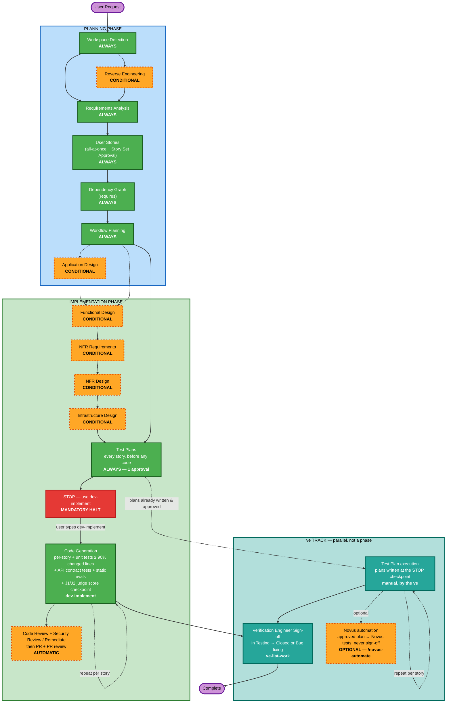

# aire Adaptive Workflow Overview

**Purpose**: Technical reference for AI model and developers to understand complete workflow structure.

**Note**: Similar content exists in welcome-message.md (user welcome message) and README.md (documentation). This duplication is INTENTIONAL - each file serves a different purpose:
- **This file**: Detailed technical reference with Mermaid diagram for AI model context loading
- **welcome-message.md**: User-facing welcome message with ASCII diagram
- **README.md**: Human-readable documentation for repository

## The Two-Phase Lifecycle:
• **PLANNING PHASE**: Planning and architecture (Workspace Detection → Requirements → User Stories → Dependency Graph → Workflow Planning → Application Design)
• **IMPLEMENTATION PHASE**: System-level design → Test Plans (every story, one approval) →  STOP → per-story Code Generation via `dev-implement` (on a story branch cut from the Base Branch — the development branch; code, then unit tests to 90% coverage on changed lines, API contract tests when an endpoint changes, full regression, static evals, the J1/J2 judge score checkpoint and the eval scorecard) → automatic Code Review (with the security review) & Remediate → `[STORY]` PR into the Base Branch and automatic PR review → two approvals, merge and DEV deploy by the team

**ve TRACK (parallel, NOT part of any phase)**: Test plan SIGN-OFF belongs to ve, not to Implementation — neither at epic level nor at story level. The plans themselves are now *authored* earlier: every story's plan, in its folder under `test-plans/` (`common/branching-strategy.md` Section 7.1), is generated at the STOP CHECKPOINT, before any code exists, and published for review (`implementation/test-plans-checkpoint.md`), by invoking the same `ve-implement` skill in WORKFLOW MODE. The Verification Engineer reviews those plans, tests each story once it is deployed to DEV and moved to `In Testing` on the board, and runs `ve-list-work` on the epic branch to close it or send it to `Bug fixing` — that remains the only sign-off path.

## The Adaptive Workflow:
• Workspace Detection (always; resolves the ADO organization and project, and captures the Parent Epic link if provided) → Reverse Engineering (brownfield only) → Requirements Analysis (always, adaptive depth) → User Stories (always; asks the pod size (`team_size`) once, no creation-mode question — all stories generated at once, each declaring the files it touches; the set requires explicit human approval — the Story Set Approval — then pushes to Azure DevOps Boards AUTOMATICALLY, linked to the Parent Epic) → Dependency Graph (always; assigns `requires`) → Workflow Planning (always) → Application Design (conditional) → System-Level Design (conditional; single pass) → Test Plans (always; every story's manual test plan, ONE approval gate) →  STOP → Code Generation (per-story, via `dev-implement`, on story branches cut from the Base Branch, with unit tests to 90% coverage on changed lines and a full regression, and NO approval gates) → Code Review & Remediate (automatic inside every implement workflow — review including the security review, auto-fix findings, re-review until clean; also invokable standalone, story-wise or all stories) → PR into the Base Branch + automatic PR review. Running alongside: the Verification Engineer track — executing each story's approved test plan once it is deployed to DEV and `In Testing`, and closing it (or sending it to `Bug fixing`) with `ve-list-work`.

## How It Works:
• AI analyzes your request, workspace, and complexity to determine which stages are needed
• **These stages always execute**: Workspace Detection (incl. automatic Epic branch creation), Requirements Analysis (adaptive depth), User Stories (pod size asked once, all-at-once generation, Story Set Approval, then automatic push to Azure DevOps Boards), Dependency Graph (`requires`), Workflow Planning, Code Generation (per-story via `dev-implement`, with unit tests to 90% coverage on changed lines)
• **All other stages are conditional**: Reverse Engineering, Application Design, system-level design stages (Functional Design, NFR Requirements, NFR Design, Infrastructure Design)
• **Also invokable standalone**: Code Review and Remediate run automatically inside every implement workflow, and can also be invoked at any time for a specific story or all stories together (`code-review`, `remediate`)
• **Verification Engineer-initiated, parallel to everything above**: executing the test plans once a story is `In Testing`, then `ve-list-work` (`In Testing → Closed`, or `Bug fixing` plus `raise-defect`; retested bugs `Resolved → Closed` or back to `Active`). Never auto-run — the Verification Engineer types it.
• Status lifecycle (`common/status-model.md`): stories ToDo → In Progress (automatic claim) → Ready for Testing (developer, on the board, after merge + DEV deploy) → In Testing (Verification Engineer, on the board) → Closed or Bug fixing; bugs New → Active (automatic claim) → In-Revision (developer doubts it, confirm-first) → Resolved (developer, on the board) → Closed or back to Active. The epic branch holds only the cycle's documents.
• **Test Plans (always, at the STOP CHECKPOINT)**: every story's manual test plan (in its folder under `test-plans/`) is written before any code is generated and published straight away — an epic cycle in its own `[TEST]` PR, a bug or enhancement cycle on its cycle branch — for the Verification Engineer to review and change with `ve-list-work` Option C; the implement workflows then read them and never author them
• **Mandatory STOP**: after the design stages and before any code generation, the workflow halts — code is generated per-story only when the user types `dev-implement`
• **No fixed sequences**: Stages execute in the order that makes sense for your specific task

## Your Team's Role:
• Answer questions in dedicated question files using [Answer]: tags with letter choices (A, B, C, D, E)
• **Option E available**: Choose "Other" and describe your custom response if provided options don't match
• Work as a team to review and approve each phase before proceeding
• Collectively decide on architectural approach when needed
• **Important**: This is a team effort - involve relevant stakeholders for each phase

## aire Two-Phase Workflow:

**Stage Descriptions:**

**PLANNING PHASE** - Planning and Architecture
- Workspace Detection: Analyze workspace state and project type (ALWAYS)
- Reverse Engineering: Analyze existing codebase (CONDITIONAL - Brownfield only)
- Requirements Analysis: Gather and validate requirements (ALWAYS - Adaptive depth)
- User Stories: Create user stories and personas (all in one pass, for the pod size `team_size` the user gives once; every story declares the files it touches); populate the Story Tracker; the generated story set requires explicit human approval (the Story Set Approval) before it pushes to Azure DevOps Boards, each story linked to the Parent Epic from `runtime-artifacts/aire-state.md` `## Tracker` (ALWAYS)
- Dependency Graph: Record each story's `requires` dependencies so independent stories can be developed in parallel; write dependency-graph.yml (ALWAYS — right after User Stories)
- Workflow Planning: Create execution plan (ALWAYS)
- Application Design: High-level component identification and service layer design (CONDITIONAL)

**IMPLEMENTATION PHASE** - Design and Implementation
- Functional Design: Detailed business logic design at the system level (CONDITIONAL, system-level)
- NFR Requirements: Determine NFRs and select tech stack (CONDITIONAL, system-level)
- NFR Design: Incorporate NFR patterns and logical components (CONDITIONAL, system-level)
- Infrastructure Design: Map to actual infrastructure services (CONDITIONAL, system-level)
- Test Plans: for EVERY story of the cycle, in one pass and under ONE approval gate — `test-plans/<cycle>/<TICKET-ID>-<title>/` (manual steps, via the `ve-implement` skill in WORKFLOW MODE). Written before any code exists, published to the Base Branch in the cycle's `[TEST]` PR (one folder per cycle, so parallel epics never conflict — `common/branching-strategy.md` Section 7), then read — never rewritten — by the implement workflows (ALWAYS, at the STOP CHECKPOINT)
- STOP: mandatory halt after the design stages and the test-plans approval, before any Code Generation
- Code Generation: Per-story, triggered by `dev-implement` only — Story Selection (by Tracker ID) → story branch cut from the Base Branch, docs through `.aire-docs/` → Part 1 Planning → Part 2 Generation → Unit Test & Coverage gate (90% on changed lines) → Test Placement check → Full Regression
- Code Review: Review a story's code, or all stories together, read-only, produce a versioned report with the diff-scoped security review (automatic inside every implement workflow; standalone via `code-review`)
- Remediate: Fix issues from a review report (fix → unit test → green, running only the in-scope story's unit tests), annotate the report in place (automatic inside every implement workflow; standalone via `remediate`)

**ve TRACK** - Parallel to Implementation, owned by ve (NOT a Implementation stage at epic or story level)
- Test Plan: authored for every story at the STOP CHECKPOINT (above) by the `ve-implement` skill in WORKFLOW MODE — it reads the acceptance criteria (the ADO board / `stories.md`), requirements and design artifacts, and writes manual test steps for every applicable test plan (integration, E2E, API, contract, security, performance, accessibility — whichever apply; there is no build-verification artifact) into the story's folder under `test-plans/`. Never reads application source code. Manual test steps only: no test automation, no test execution. The Verification Engineer executes them once a story's code is on the branch. A standalone `/ve-implement` run on a story publishes its reworked docs through the cycle's `[TEST]` PR on an epic, or its own `ve/...` branch and PR on a bug or enhancement
- Verification Engineer Sign-off: Triggered by `ve-list-work` on the cycle's docs branch (epic branch for epic cycles, bug/enhancement branch for those cycles) — pulls latest, lists stories and bugs by their live status, then takes one decision per item: a story `In Testing` → `Closed` or `Bug fixing`; a bug `Resolved` → `Closed` or `Active`; a bug `In-Revision` → `Closed` when it is not a bug — applied in the Story Tracker and on the ADO board (Verification Engineer-initiated, confirm-first)

**Key Principles:**
- Phases execute only when they add value
- Each phase independently evaluated
- PLANNING focuses on "what" and "why"
- IMPLEMENTATION focuses on "how" — Test Plan is ve's parallel track, not a Implementation stage
- Simple changes may skip conditional PLANNING stages
- Complex changes get full PLANNING and IMPLEMENTATION treatment
---

## Bug/Defect Flow (variant)

When `runtime-artifacts/aire-state.md` `## Tracker` records `Workflow Type: bug` (started via `ticket-implement <TICKET-ID>` routed to bug, or the direct keyword `bug-fix <TICKET-ID>`, on an existing ADO Bug/Story work item), the lifecycle is the TRIMMED variant defined in `workflows/bug-fix.md` + `workflows/bug-fix-implement.md` — ONE flow with a single break at design-done — the ve Handoff Break (`bug-fix.md` Step 9: analysis + design artifacts committed and pushed on the bug branch, the Verification Engineer told to pull it and run `/ve-implement <TICKET-ID>`, then a yes/no that continues into the fix in the same session, no second keyword) — NOT the epic flow above:
• ONE branch `bug/<TICKET-ID>-<title>` from the base branch (no epic/story branches) • Impact Analysis + line-level AI-Origin Detection via `agents/defect-provenance-analyst.md` (traces each defective line to its introducing commit; may label the ticket `ai-generated-defect`; resolves the originating story/bug/enhancement ticket and links the bug to it as `is caused by` — automatic, no confirmation; a Related link plus an authoritative comment on the bug, `common/tracker-sync.md` Section 7) • ONE story from the ticket, NO Dependency Graph, no tracker story push • no PR at requirements approval — a single `[BUG]` PR to the base branch at the end • baseline + full regression runs around the fix • ticket stays `Active` after the PR — after the two approvals, the merge into the development branch and the DEV deploy, the developer moves it to `Resolved` on the board and the Verification Engineer retests it with `ve-list-work` Option B (`Closed`, or back to `Active`) — `common/status-model.md` B6–B9 • MANUAL archive — the operator runs `archive-epic` (→ `aire-archives/bugs/<BUG-ID>-<name>/`) once the ve test-plan PR has merged into the bug branch, and before the `[BUG]` PR merges; the workflow NEVER auto-invokes it. archive-epic writes this cycle's RE delta to `spec/plans/delta/<TICKET-ID>-<slug>/`, archives it, and removes the live `spec/`/`reports/`/`runtime-artifacts/` trees; once the `[BUG]` PR merges, the operator runs `/stitch-delta` on the base branch, which reads that delta from the archive and publishes it to the Atlas deep dive via the Helix MCP (its own PR is a single ledger row) — so the next cycle pulls truth from Atlas that already includes this one.
A resumed session MUST check `Workflow Type` FIRST and follow the bug workflow files when it is `bug`.
