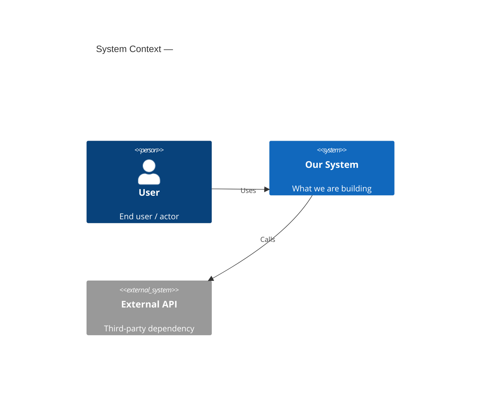
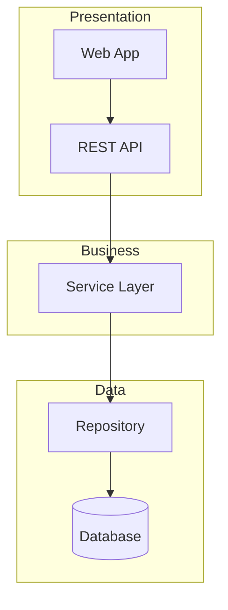
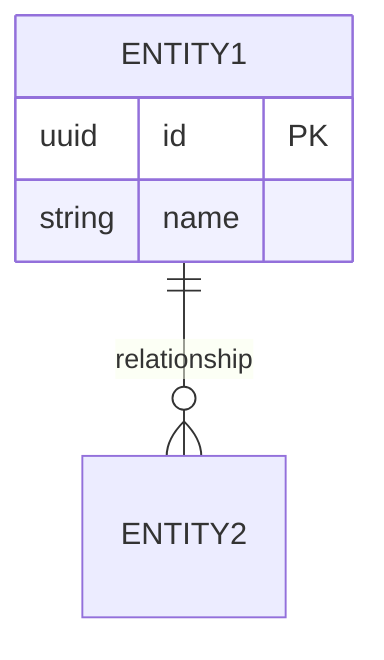

# `architecture.md` — The System Architecture Document

**Purpose**: one document that states how this system is built. It is written once, at the end of
the Implementation-phase design stages, and it is the source of truth for every downstream
code-generation and code-review decision about structure.

**Written ONCE per cycle — never per story.** A story gets no architecture document of its own; it
reads the relevant section of this one. One source, no copies, nothing to drift.

**Location**: `spec/plans/architecture.md`

**When**: STOP CHECKPOINT Step 1.1 — after Infrastructure Design completes (or after the design
stages are skipped), right after `package-dependencies.md` (Step 1.0), before the test plans and the
design commit.

**Load this file when**: writing or updating `architecture.md`.

---

## 1. It is ASSEMBLED from the design stages, not authored fresh

`architecture.md` consolidates decisions that have already been made and approved. It introduces no
new architecture. Its inputs, in precedence order:

1. **Atlas existing-system truth** (brownfield) — `common/helix-atlas-integration.md`. The existing
   architecture is the starting state; this document records the target state and the delta.
2. `spec/plans/functional-design.md`
3. `spec/plans/nfr.md` (its `## NFR Requirements` and `## NFR Design` sections)
4. `spec/plans/infrastructure-design.md`
5. `spec/plans/application-design.md`
6. `## Design References` registered in `runtime-artifacts/aire-state.md`, and the `### Reconciliations` table (a point
   already decided there is settled — never reopen it)
7. `spec/plans/package-dependencies.md` — the approved package and runtime versions. Wherever this
   document names a technology it uses the approved version, never a different one.

**If a design stage was skipped**, the corresponding section says so explicitly and states what the
system does by default instead. Never leave a section silently empty, and never invent a decision
to fill it — every later story is built and reviewed against what this document says.

---

## 2. Required structure

````markdown
# Architecture — <system name>

> **Version**: <semver> · **Generated**: <ISO 8601> · **AIRE**: v<N>
> **Derived from**: <list every source artifact path>
> **Existing-system baseline**: Atlas via Helix MCP <estate id> | none (greenfield)

## 1. System Context
<What the system does, who/what calls it, what it calls. One C4 context diagram + prose.
 Brownfield: annotate every element as existing / new / modified.>



## 2. Component Inventory
| Component | Responsibility | Status | Source |
|---|---|---|---|
| BillingService | Plan changes and proration | existing (modified) | Atlas atlas-deep-dive.md |
| ProrationEngine | Prorated amount calculation | new | functional-design/billing.md |

<One component diagram. Group components by layer with subgraphs.
 Brownfield: label each node existing / new / modified, matching the Status column above.>



## 3. Layering and Boundaries
<The layers, what may call what, and what is forbidden. State the rule, not the aspiration.>

## 4. Data Architecture
<Stores, ownership per component, schemas/models introduced or changed, migration approach,
 transaction boundaries. Include one ER diagram of the entities this system owns or changes.
 Brownfield: annotate entities/fields new vs existing.>



## 5. API and Integration Contracts
<Every externally reachable contract this system exposes or consumes: protocol, shape,
 error model, versioning, auth model.>

## 6. Cross-Cutting Decisions
<AuthN/AuthZ · error handling and error taxonomy · logging and redaction · configuration and
 secrets · observability · resilience patterns · concurrency and idempotency.>

## 7. Non-Functional Targets
| Concern | Target | Source | How it is verified |
|---|---|---|---|
| p95 latency, /upgrade | < 800 ms excl. provider call | spec/plans/nfr.md | load test |

## 8. Infrastructure and Deployment
<Runtime topology, environments, deployment unit, scaling model, external dependencies.>

## 9. Delta from the Existing System   ← brownfield only
| Area | Before (Atlas) | After | Reason |
|---|---|---|---|

## 10. Explicitly Out of Scope
<Architecture the system deliberately does NOT have, so nobody adds it speculatively.>

## 11. Security Decisions
<See Section 2.2. One row per security-hook rule the approved requirements or design make
 inapplicable somewhere, e.g. a public endpoint. "None" when there are none.>
| Rule | Applies to | Decision | Source |
|---|---|---|---|
````

---

## 2.1 Diagrams — authored inline in architecture.md

Every `architecture.md` carries its Mermaid diagrams **inline, in the sections above — there is no
separate diagram file.** Use the scaffolds in Section 2 verbatim as the starting point and fill them
from the design artifacts; never invent a diagram a design stage did not establish.

**Diagram types and where each lives:**

| # | Type | Mermaid dialect | Section | When |
|---|---|---|---|---|
| 1 | System Context | `C4Context` | Section 1 | ALWAYS |
| 2 | Component Architecture | `flowchart TB` with layer `subgraph`s | Section 2 | ALWAYS |
| 3 | Data Model | `erDiagram` | Section 4 | when the work introduces or changes any store/schema |
| 4 | Key Flow(s) | `sequenceDiagram` | Section 5 or 6 | when a cross-component request path or integration needs to be made explicit |

**Brownfield annotation rule** — on any brownfield/migration cycle, EVERY diagram must mark each
element as existing / new / modified (e.g. `ModB[ModuleB — modified]`,
`System_Ext(newExt, "New Integration", "added for <feature>")`), and the labels must agree with the
Component Inventory `Status` column (Section 2) and the Delta table (Section 9). Greenfield diagrams
carry no such annotation.

Validate every diagram per `common/content-validation.md` (Mermaid syntax) BEFORE writing the file.

---

## 2.2 Section 11 Security Decisions — where the security hook stands down

The security hook (`aire-workflow/hooks/check-security.cjs`, run by the Claude Code hooks in
`.claude/settings.json`) blocks every Security Baseline rule a pattern can decide, on the lines a change
adds. Where the approved requirements or design call for something one of those rules forbids — a
public, unauthenticated endpoint that needs CORS `*`, an all-egress rule an integration requires — the
decision is recorded here, and the hook skips that rule for those paths only.

```markdown
| Rule | Applies to | Decision | Source |
|---|---|---|---|
| access/cors-any-origin | src/public-catalogue/** | Public, read-only catalogue API: no cookies, no auth | REQ-NF-04 |
```

- **Rule** — a rule id from `node aire-workflow/hooks/check-security.cjs rules`.
- **Applies to** — a path or glob (`*`, `**`), as narrow as the decision allows.
- **Decision** — why the rule does not apply there, in one sentence.
- **Source** — a live REQ-ID in `requirements.md`, or the design document that made the decision
  (`nfr.md`, `functional-design.md`, `infrastructure-design.md`, `application-design.md`). A row whose
  Source resolves to nothing, or that names no rule, is ignored and the hook says so.

A row exists only because a requirement or design decision already approved says so; otherwise the
section reads "None". On a story branch the hook reads this section from the epic branch as committed
and refuses edits to it, so a story never widens it for itself. A needed decision goes through
`epic-change-request`, which amends it on the epic branch. Section 3 amendments never touch Section 11.

---

## 3. Keeping it true over the cycle

`architecture.md` is living. When a story legitimately changes an architectural decision:

1. Update the relevant section.
2. Bump the version (patch for clarification, minor for a changed decision).
3. Record the change in `runtime-artifacts/audit.md` under `## Architecture Amended (<story-key>)`, with
   what changed and why.
4. Announce it — every subsequent story is built and reviewed against the amended decision.
5. Re-derive `spec/plans/judge-rubrics.md` (Section 6) in the same commit, with the new version.

Amend it only when the *design decision itself* was wrong or has genuinely moved — never to make a
review finding go away — and say so plainly in the audit entry, with the reason.

---

## 4. Completion announcement

```
 Architecture document written — spec/plans/architecture.md v<version>
   Components: <n> (<x> new, <y> modified)   Sources: <n> design artifacts
   Diagrams: System Context · Component Architecture[ · Data Model][ · Key Flows]
```

Log the same in `runtime-artifacts/audit.md`. The file is committed with the design artifacts at the
STOP CHECKPOINT.

## 5. R6 re-check against the component layout (MANDATORY — right after the announcement)

With the component layout now concrete, run the STOP CHECKPOINT re-check in
`planning/dependency-graph-generation.md` (R6 — Conflict-Free Independence): refine every story's
`touches` to real paths (named per the team's coding guidelines, `implementation/code-generation.md`
Step 1.8, when there are any), re-run the plan-time check, add any new R6 edges, and update
`dependency-graph.yml`, the `Requires` column and `stories.md`. Announce the result
(`R6 re-check: clean` or the edges added). It is automatic, asks nothing, and its changes ride the
design commit.

## 6. Judge rubrics — J1 and J2 (MANDATORY — right after the R6 re-check)

The judge scores (`implementation/code-generation.md` Step 11c.6) grade each story's diff against two
rubrics. They are derived here, from approved documents, so every score is measured against a bar a
human already agreed to. Write both to `spec/plans/judge-rubrics.md`, with `Rubric version` equal
to the `architecture.md` version. Automatic, asks nothing, rides the design commit.

**J1 — Architecture conformance.** One criterion per enforceable rule that `architecture.md` states,
taken from its Sections 3 (layering and boundaries), 4 (data ownership and transaction boundaries), 5
(API and integration contracts), 6 (cross-cutting decisions: auth, error handling, logging and
redaction, configuration and secrets) and 10 (explicitly out of scope). Same wording as the document,
never a generic best practice. A rule that cannot be checked against a diff is left out and listed
under the table with the reason.

**J2 — Security.** One criterion per OWASP Top 10:2025 category the stack can exercise, each tied to
the Security Baseline rule that governs it (`extensions/security/baseline/security-baseline.md`):

| ID | OWASP 2025 category | Typical Security Baseline rules |
|---|---|---|
| A01 | Broken Access Control | SECURITY-08 |
| A02 | Security Misconfiguration | SECURITY-04, SECURITY-09 |
| A03 | Software Supply Chain Failures | SECURITY-10 |
| A04 | Cryptographic Failures | SECURITY-01, SECURITY-16 |
| A05 | Injection | SECURITY-05 |
| A06 | Insecure Design | SECURITY-11 |
| A07 | Authentication Failures | SECURITY-12 |
| A08 | Software or Data Integrity Failures | SECURITY-13 |
| A09 | Security Logging and Alerting Failures | SECURITY-03, SECURITY-14 |
| A10 | Mishandling of Exceptional Conditions | SECURITY-15 |

A category the stack cannot exercise (for example A05 on a service with no data store, query or shell
call) is left out, with the reason.

**Format** of `spec/plans/judge-rubrics.md` — one table per rubric:

```markdown
# Judge Rubrics
> Rubric version: <architecture.md version> · Derived: <ISO 8601> · AIRE: v<N>

## J1 — Architecture conformance
| ID | Criterion | Scores 0 when the diff shows | Weight | Source |
|---|---|---|---|---|
| J1-01 | Controllers never query the database | a repository or ORM call in a controller or route handler | 0.25 | architecture.md Section 3 |

## J2 — Security (OWASP Top 10:2025)
| ID | Criterion | Scores 0 when the diff shows | Weight | Source |
|---|---|---|---|---|
| J2-A01 | Every new endpoint enforces authorization | a route added without the project's auth guard | 0.20 | OWASP A01 · SECURITY-08 |
```

- Every criterion is binary and citable: its "Scores 0 when" column names a code pattern a reviewer can
  point at in a diff. No aesthetic judgements.
- Weights in each table sum to 1.0, biased toward what this system is most exposed to.
- **Never hand-edit the rubric to change a score.** It changes only when `architecture.md` changes
  (Section 3 above): re-derive it in the same commit and give it the new version. The stack or the
  security context changing re-derives J2 the same way.
- No `architecture.md` and no existing-system documents to derive J1 from → write the J1 table empty
  with `J1: N/A — no architecture document`. J2 is always derivable.

Announce it (` Judge rubrics written — J1: <n> criteria · J2: <n> criteria · v<version>`) and log it.
